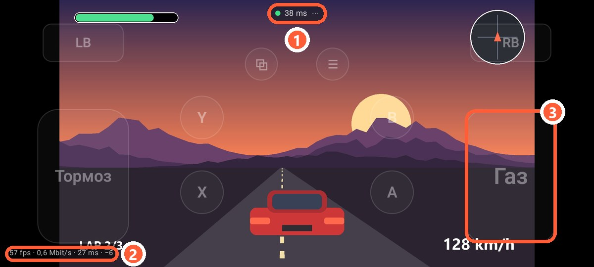
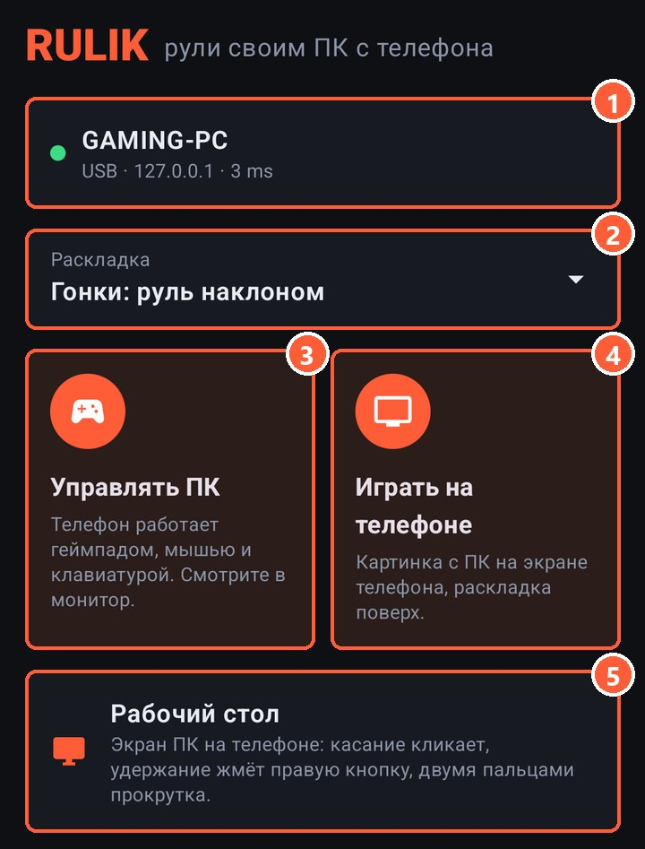
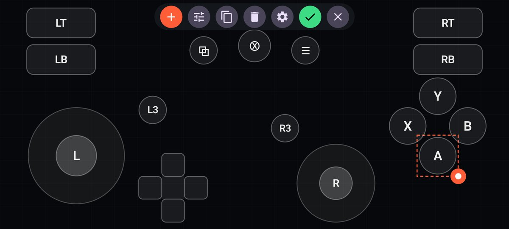
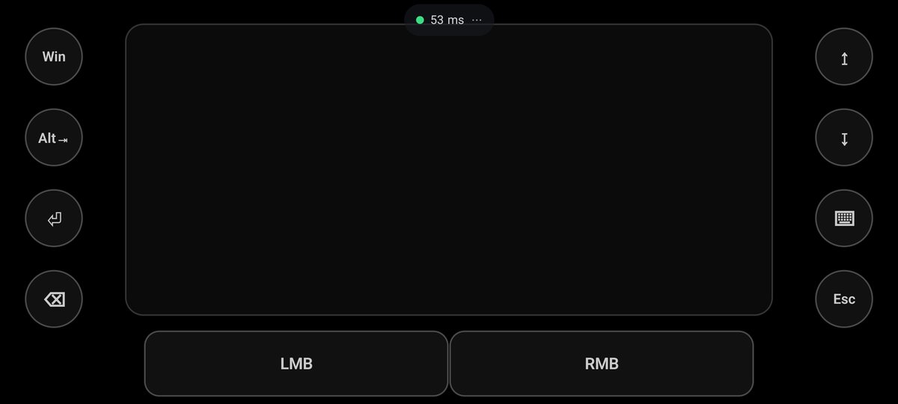

<p align="center"></p>

<h1 align="center">Rulik</h1>

<p align="center"><b>Control your PC from your phone.</b> Your Android phone becomes an Xbox gamepad, a mouse and a keyboard,<br>and you can play your PC games right on the phone's screen.</p>

<p align="center">
  <a href="https://wandraker.github.io/rulik/en/">Website</a> ·
  <a href="https://github.com/Wandraker/rulik/releases/latest">Download</a> ·
  <a href="https://wandraker.github.io/rulik/en/wiki/">Wiki</a> ·
  <a href="README.md">Русский</a>
</p>

<p align="center">
  
  
</p>

## Features

- **An Xbox 360 gamepad for any game.** The server creates a virtual controller through the ViGEmBus driver, so the game sees a regular wired Xbox pad. It doesn't matter where the game came from: Steam, Epic, GOG, the Xbox app or a disc.
- **Even in games without gamepad support.** On-screen buttons and sticks can be bound to keys and the mouse, so the game thinks you're on a keyboard. That way you can play strategy games, old games and anything with no gamepad support at all from your phone. Ready-made layouts: "Shooter: WASD + mouse" in the app and Minecraft on the website.
- **Play right on the phone.** The PC's picture and sound go to the phone's screen, with your layout drawn on top. The PC compresses the video on the graphics card (NVENC, AMF or Quick Sync), and latency over 5 GHz Wi-Fi is usually 20–40 ms. For the couch and the next room.
- **The PC desktop on the phone.** The PC screen you control with your finger: tap to click, hold for right click, two fingers to scroll.
- **Mouse and keyboard.** A touchpad with gestures (tap, two-finger right click, scrolling, dragging), any key and combos of up to 4 keys, and typing text straight on the PC.
- **Wi-Fi or cable.** UDP over Wi-Fi with 2–10 ms of latency. Over a cable through USB tethering (no debugging needed) or `adb reverse`.
- **Layout editor.** Buttons, sticks, D-pads and touchpads. Drag them around, resize them and pick a mode: hold, toggle or turbo. A stick can drive the left or right stick, WASD, arrows, the D-pad or the mouse.
- **Fewer misses.** A tap in the gap between buttons goes to the closest one, the phone clicks with a short vibration at button edges, and each button's invisible hit zone adapts to where you actually press. All of it can be turned off in the settings.
- **Gyro and tilt.** Gyro aiming (mouse or right stick, always on or while a button is held) and tilt steering for racing games.
- **Game rumble.** The gamepad's motors are passed on to the phone's vibration motor.
- **Several phones.** Each one gets its own gamepad, up to 8 per PC, which is handy for couch co-op.
- **PIN protection.** Without the PIN from the server window, another phone on the network can't control your PC.
- **English and Russian** in the app, the server and the website.

## Quick start

1. Download [`rulik-server.exe`](https://github.com/Wandraker/rulik/releases/latest/download/rulik-server.exe) and run it on a Windows 10 or 11 PC. If the window warns about the driver, press "Install driver" and restart the server.
2. Install [`rulik.apk`](https://github.com/Wandraker/rulik/releases/latest/download/rulik.apk) on your phone (Android 10+).
3. In the app, pick your PC on the PC tab and enter the PIN from the server window. On the Home tab, pick a layout and tap "Control the PC" or "Play on the phone".

Playing on the phone needs ffmpeg on the server. If it's missing, the server window has a "Download ffmpeg" button.

Guides, troubleshooting and everything about gamepads in the wiki: [wandraker.github.io/rulik/en/wiki/](https://wandraker.github.io/rulik/en/wiki/).

<p align="center">
  
  
</p>

## What's inside

| Folder | Contents |
|--------|----------|
| [`android/`](android) | The app: Kotlin, Jetpack Compose, minSdk 29 |
| [`server/`](server) | Rulik Server for Windows: Python, SendInput, ViGEmBus through [vgamepad](https://github.com/yannbouteiller/vgamepad), screen streaming through ffmpeg, sound through WASAPI, a tkinter window |
| [`site/`](site) | The GitHub Pages website: static bilingual pages and a layout gallery |
| [`docs/PROTOCOL.md`](docs/PROTOCOL.md) | The network protocol |

## Building

**App** (JDK 17+, Android SDK):

```bash
cd android
./gradlew assembleRelease
```

UI strings live in `android/tools/strings.py`. After editing them, run `python android/tools/strings.py`.

**Server** (Python 3.12+, Windows):

```bash
cd server
python -m unittest discover -s tests
powershell -File build.ps1
```

To run from source: `python run.py`. The `--dry` flag prints input to the console instead of sending it to Windows, and `--nogui` runs the server without a window.

**Website:**

```bash
python site/build.py
```

The pages end up in `site/dist`.

## Releases

A `vX.Y.Z` tag builds the APK and the exe and publishes a GitHub release. The tag version must match `versionName` in `android/app/build.gradle.kts` and `__version__` in `server/rulik/__init__.py`. The APK is signed with the key from the `KEYSTORE_BASE64` and `KEYSTORE_PASSWORD` secrets.

## License

Copyright © 2026 Wandraker. [GPL-3.0](LICENSE). You may use, change and share the code, but any modified version must also be open source under GPL-3.0 and keep the credits. Passing Rulik off as your own closed app is not allowed.

The website (the [site](site) folder: texts, screenshots, design) is not covered by GPL-3.0; all rights are reserved, see [site/LICENSE](site/LICENSE).

ViGEmBus, vgamepad and ffmpeg are distributed under their own licenses. ffmpeg isn't bundled with Rulik Server: the server downloads it separately from the ffmpeg build sites.
