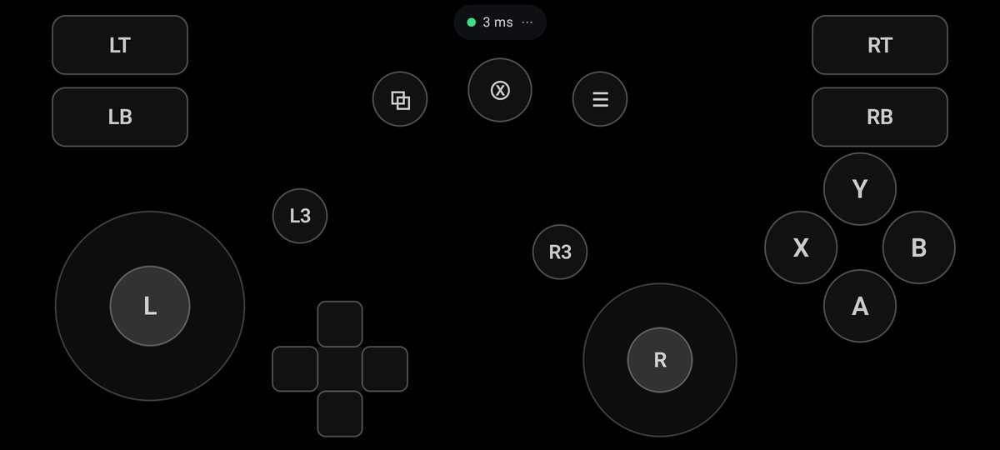
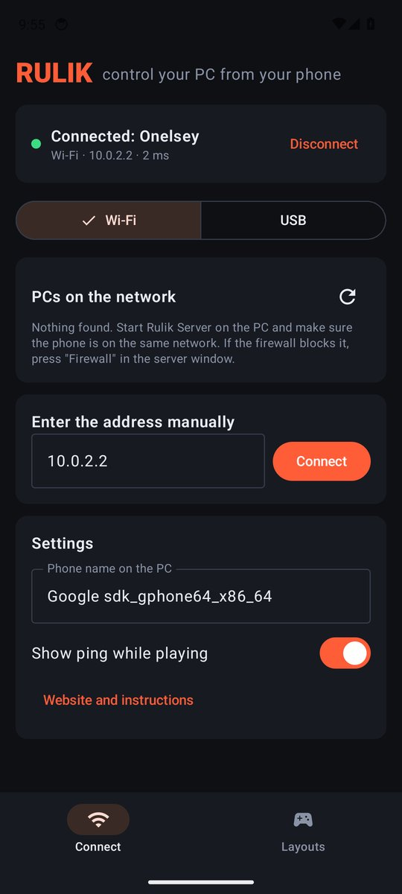
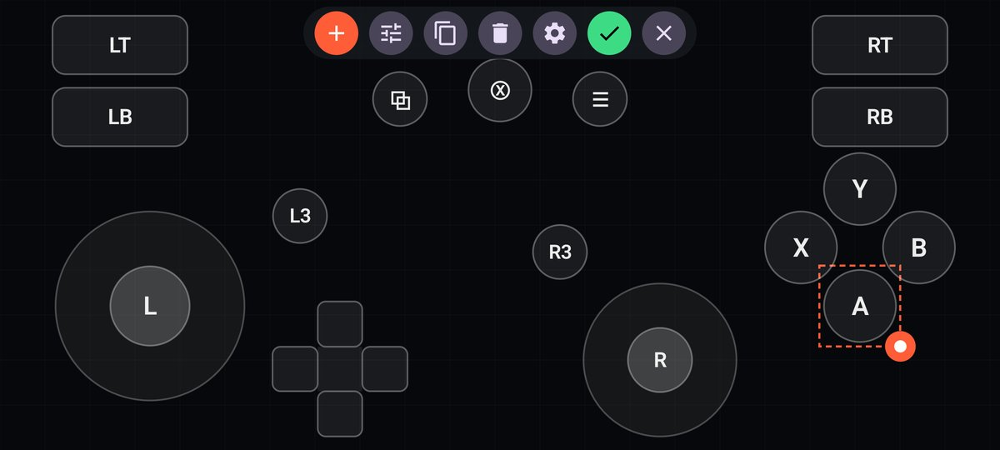
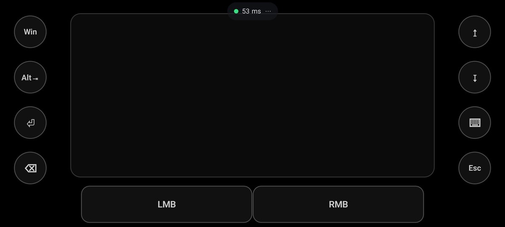

<p align="center"></p>

<h1 align="center">Rulik</h1>

<p align="center"><b>Рули своим ПК с телефона.</b> Android-телефон становится геймпадом Xbox, мышью и клавиатурой.<br>Любая игра, Wi-Fi или кабель, свои раскладки.</p>

<p align="center">
  <a href="https://wandraker.github.io/rulik/">Сайт</a> ·
  <a href="https://github.com/Wandraker/rulik/releases/latest">Скачать</a> ·
  <a href="https://wandraker.github.io/rulik/guide.html">Как подключить</a> ·
  <a href="README.en.md">English</a>
</p>

<p align="center">
  
  
</p>

## Что умеет

- **Геймпад Xbox 360 для любой игры.** Сервер создаёт виртуальный контроллер через драйвер ViGEmBus, и игра видит обычный проводной Xbox. Неважно, где взята игра: Steam, Epic, GOG, Xbox app, диск.
- **Даже в играх без поддержки геймпада.** Кнопки и стики на экране можно назначить на клавиши и мышь: игра думает, что вы играете на клавиатуре. Так можно играть с телефона в стратегии, старые игры и всё, где геймпада нет вообще. Готовые раскладки: «Шутер: WASD + мышь» в приложении, Minecraft на сайте.
- **Мышь и клавиатура.** Тачпад с жестами (тап, правый клик двумя пальцами, прокрутка, перетаскивание), любые клавиши и сочетания до 4 клавиш, набор текста прямо на ПК.
- **Wi-Fi или кабель.** UDP по Wi-Fi с пингом 2–10 мс. По кабелю через USB-модем (без отладки) или через `adb reverse`.
- **Редактор раскладок.** Кнопки, стики, крестовины, тачпады. Двигайте пальцем, меняйте размер, задавайте режимы: удержание, переключатель, турбо. Стик можно отправить в левый или правый стик, WASD, стрелки, крестовину или мышь.
- **Гироскоп и наклон.** Гироприцел (мышь или правый стик, постоянно или пока зажата кнопка) и руль наклоном для гонок.
- **Вибрация из игры.** Моторы геймпада передаются на вибромотор телефона.
- **Несколько телефонов.** Каждый получает свой геймпад, до 8 на один ПК: удобно для игр вдвоём на одном экране.
- **Защита PIN-кодом.** Без PIN из окна сервера чужой телефон в сети управлять ПК не сможет.
- **Русский и английский** в приложении, на сервере и на сайте.

## Быстрый старт

1. Скачайте [`rulik-server.exe`](https://github.com/Wandraker/rulik/releases/latest/download/rulik-server.exe) и запустите на ПК с Windows 10 или 11. Если в окне есть предупреждение про драйвер, нажмите «Установить драйвер» и перезапустите сервер.
2. Поставьте на телефон (Android 10+) [`rulik.apk`](https://github.com/Wandraker/rulik/releases/latest/download/rulik.apk).
3. В приложении выберите свой ПК на вкладке «Подключение», введите PIN из окна сервера, откройте «Раскладки» и нажмите ▶.

Подробная инструкция с USB, брандмауэром и советами против лагов: [wandraker.github.io/rulik/guide.html](https://wandraker.github.io/rulik/guide.html).

<p align="center">
  
  
</p>

## Из чего состоит

| Папка | Что внутри |
|-------|------------|
| [`android/`](android) | Приложение: Kotlin, Jetpack Compose, minSdk 29 |
| [`server/`](server) | Rulik Server для Windows: Python, SendInput, ViGEmBus через [vgamepad](https://github.com/yannbouteiller/vgamepad), окно на tkinter |
| [`site/`](site) | Сайт на GitHub Pages: статичные страницы на двух языках, галерея раскладок |
| [`docs/PROTOCOL.md`](docs/PROTOCOL.md) | Описание сетевого протокола |

## Сборка

**Приложение** (JDK 17+, Android SDK):

```bash
cd android
./gradlew assembleRelease
```

Строки интерфейса редактируются в `android/tools/strings.py`, после правки запустите `python android/tools/strings.py`.

**Сервер** (Python 3.12+, Windows):

```bash
cd server
python -m unittest discover -s tests
powershell -File build.ps1
```

Запуск из исходников: `python run.py`. Флаг `--dry` печатает ввод в консоль вместо отправки в Windows, а `--nogui` запускает сервер без окна.

**Сайт:**

```bash
python site/build.py
```

Готовые страницы появятся в `site/dist`.

## Релизы

Тег `vX.Y.Z` собирает APK и exe и публикует релиз на GitHub. Версия в теге должна совпадать с `versionName` в `android/app/build.gradle.kts` и `__version__` в `server/rulik/__init__.py`. APK подписывается ключом из секретов `KEYSTORE_BASE64` и `KEYSTORE_PASSWORD`.

## Лицензия

Copyright © 2026 Wandraker. [GPL-3.0](LICENSE). Код можно брать, менять и распространять, но любая изменённая версия тоже должна быть открытой под GPL-3.0 и с указанием авторства. Выдавать Rulik за своё закрытое приложение нельзя.

ViGEmBus и vgamepad распространяются под своими лицензиями.
