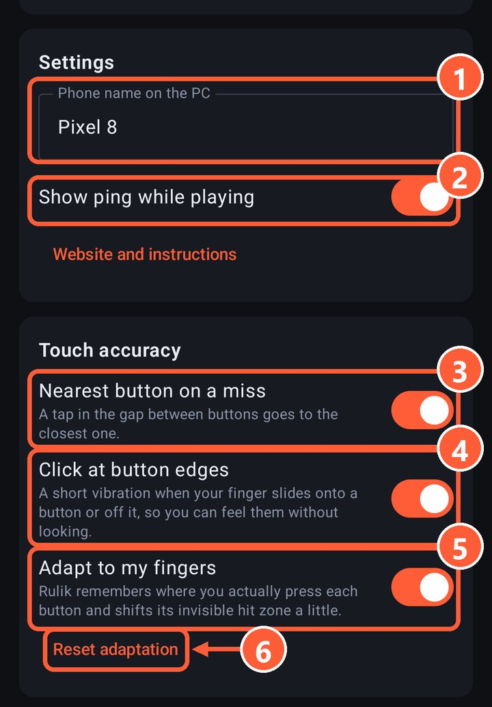

All three settings are in the app on the Connect tab, under "Touch accuracy". They're all on by default, and each can be turned off on its own.

3 Nearest button on a miss
4 Click at button edges
5 Adapt to my fingers
6 Reset adaptation

## Nearest button on a miss

A tap in the gap between buttons goes to the closest button or D-pad, as long as it's within about half a finger. If there's nothing nearby, nothing is pressed.

A tap on the button itself always stays that button's press: this only kicks in on misses. Sticks and touchpads don't attract misses, so the camera won't jerk by accident.

## Click at button edges

A short vibration when your finger slides off a button or onto the next one, so you can find buttons by feel without looking at the screen. It works even if "Vibrate on press" is off in the layout.

## Adapt to my fingers

A thumb almost never lands in the center of a button: usually a bit lower and closer to the palm. Rulik remembers where you actually press each button and, after the first 8 presses, shifts its invisible hit zone slightly that way.

- The shift is small, at most 40% of the button's size.
- A drawn neighbouring button always wins over a shifted zone.
- Each layout has its own adaptation.

Changed your grip or handed the phone to someone else? Tap "Reset adaptation" and Rulik starts learning from scratch.

## Still missing?

Make the button bigger or move it in the [editor](editor.html). It works best when the buttons under your thumbs are large and the rarely used ones are small and further away.
