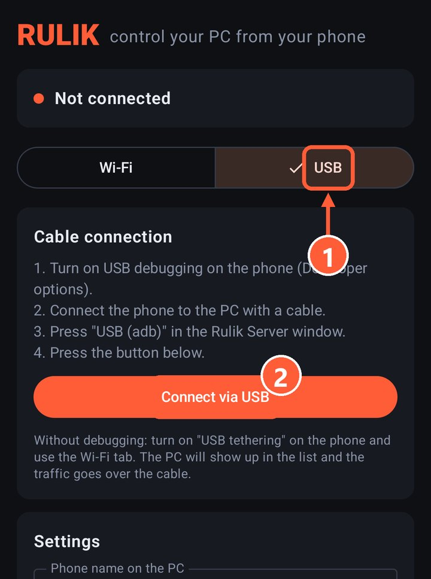
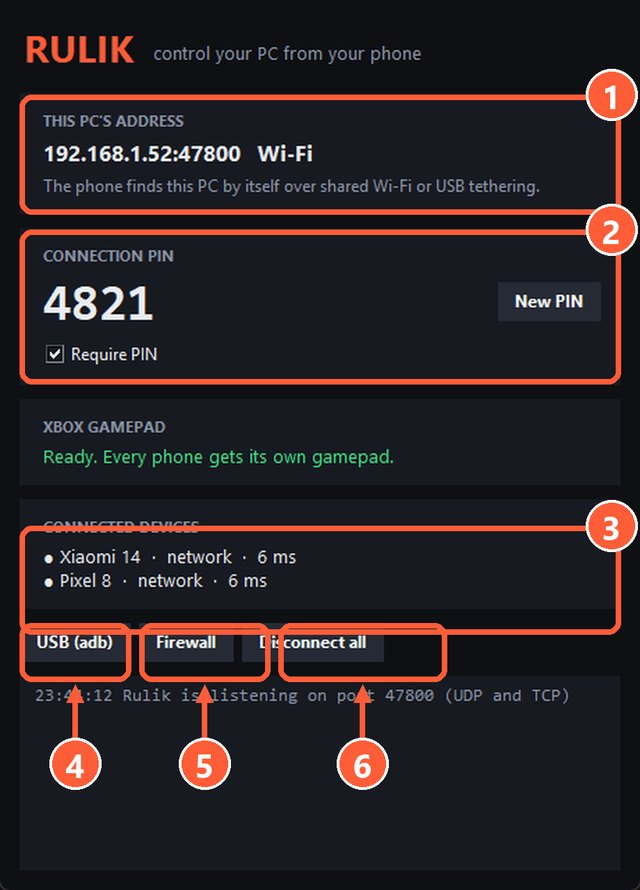

## What you need

- USB debugging turned on in the phone's Developer options. If there's no such section, open About phone and tap the build number several times (the exact item name varies between phones).
- `adb.exe` on the PC: install [platform-tools](https://developer.android.com/tools/releases/platform-tools) or put `adb.exe` next to the server.

## How to connect

1. Connect the phone to the PC with a cable and allow debugging when the phone asks.
2. Press "USB (adb)" in the Rulik Server window.
3. In the app, switch to USB and tap "Connect via USB".

1 The USB tab
2 Connect via USB

4 "USB (adb)" forwards the port over the cable

> Press "USB (adb)" again after reconnecting the cable.

Don't want to turn on debugging? Use [USB tethering](usb-tether.html).
