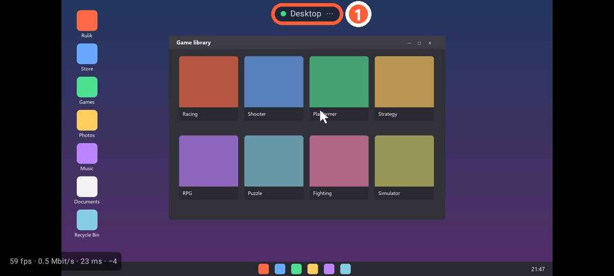

## How to open it

Tap "Desktop" on the app's home screen. It needs the same Rulik Server 0.3.0 with ffmpeg as [playing on the phone](stream.html).

1 Menu: keyboard and exit

## Gestures

| Gesture | What it does |
|---|---|
| Tap | Left click at that spot |
| Hold for half a second | Right click, the phone vibrates briefly |
| Drag | Drag with the left button held: select, move a window |
| Two fingers up or down | Scroll the wheel |
| Two-finger tap | Right click |

The cursor jumps to where you touch: it's not a touchpad, your finger lands right on the point on the screen.

## Text

The menu at the top has "Keyboard": whatever you type on the phone appears on the PC right away. Enter, Backspace, Tab and Esc are there too.

## Several monitors

The main Windows monitor is shown. To use another one, make it the main display in the Windows display settings.
