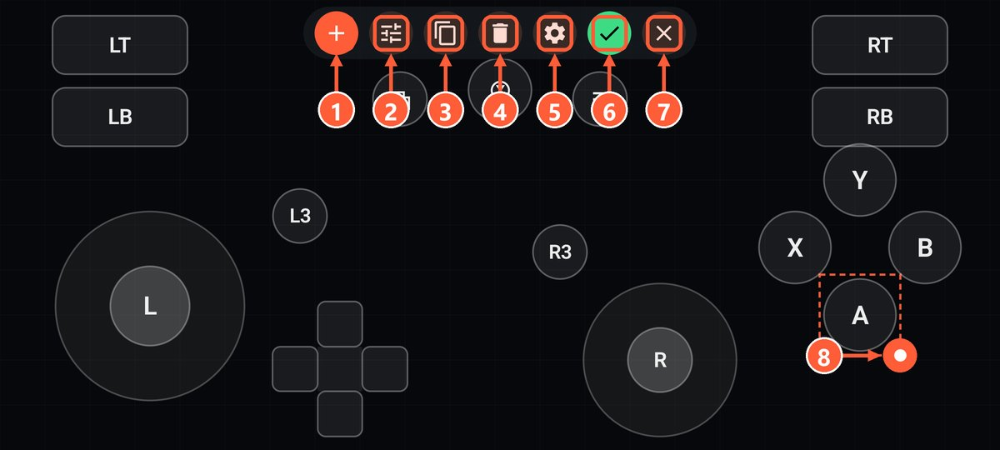
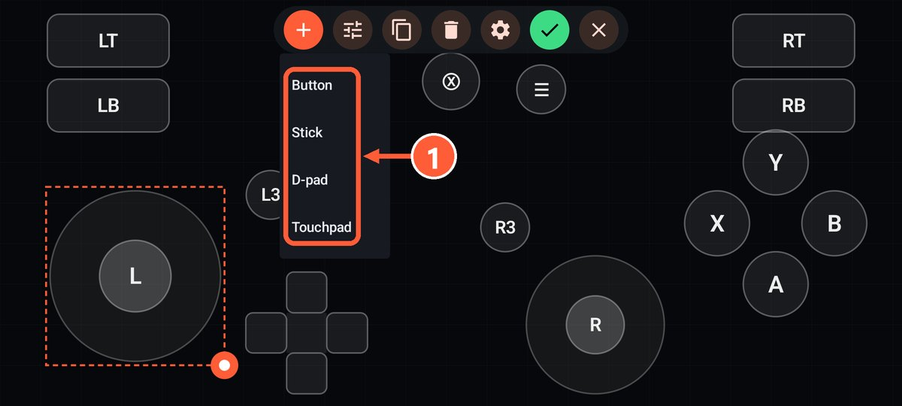
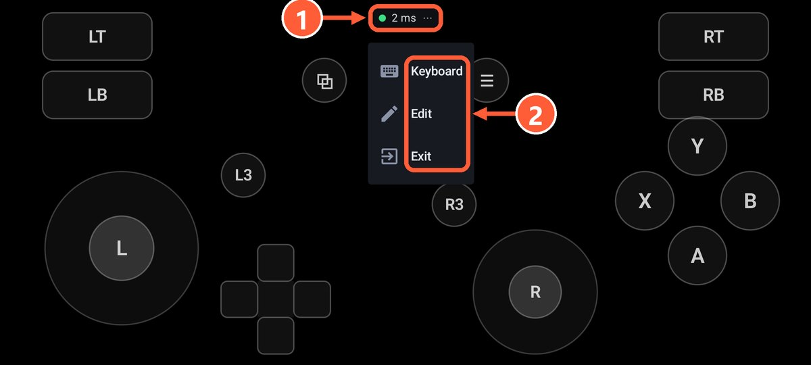
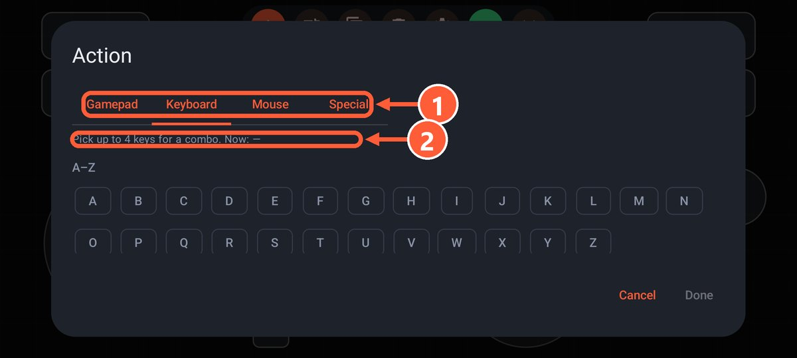
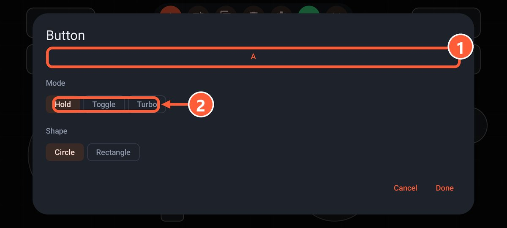
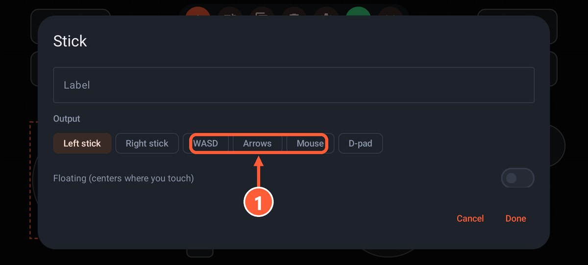
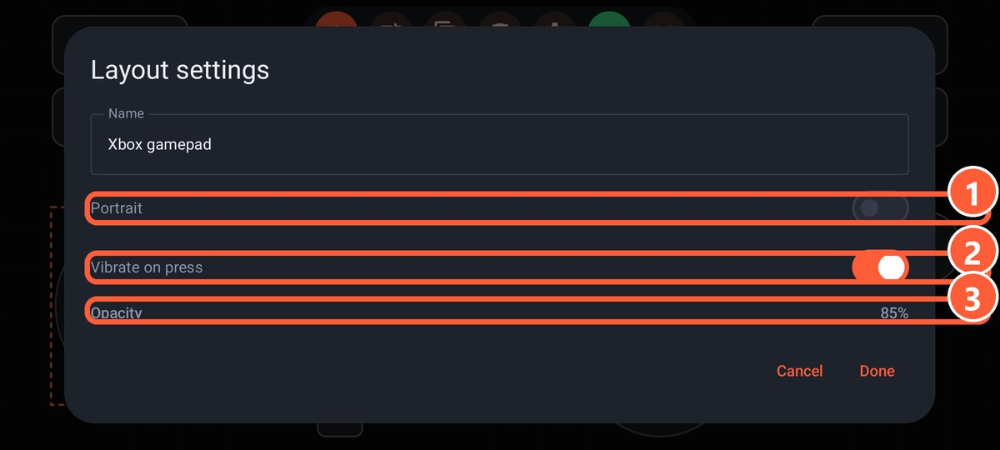

## Opening it

In the layouts list, tap ⋮ and Edit. In the middle of a game, the editor opens with the "⋯" button.

- **+** adds a button, stick, D-pad or touchpad.
- Drag a control to move it, pull the corner circle to resize it.
- The sliders button opens the control's properties.
- The gear opens the settings of the whole layout.

1 Add a control
2 Properties of the selected control
3 Duplicate the control
4 Delete the control
5 Layout settings
6 Save
7 Close without saving
8 Drag the circle to resize

1 Button, stick, D-pad or touchpad

1 Tap the ping pill
2 Typing on the PC, layout editor, exit

## Button

The **Action** is picked on one of the tabs:

- **Gamepad**: any Xbox button, triggers, bumpers, stick clicks.
- **Keyboard**: any key or a combo of up to 4 keys, like Ctrl+Shift+Esc.
- **Mouse**: left, right, middle and side buttons, wheel up and down.
- **Special**: "Gyro while held" and "Open the keyboard" for typing on the PC.

1 Tabs: gamepad, keyboard, mouse, special
2 The selected combo: pick up to 4 keys

**Mode**:

- **Hold**: pressed while your finger is down.
- **Toggle**: the first tap presses it, the second releases it. Handy for sprinting or aiming.
- **Turbo**: while held, the button fires many times a second. The speed is adjustable.

A button also has a label and a shape: circle or rectangle.

1 Action: tap to choose
2 Mode: hold, toggle or turbo

## Stick

**Output**: left stick, right stick, WASD, arrows, D-pad or mouse.

- **Floating**: the stick centers where you touch, so you don't have to hit it exactly.
- **Dead zone**: how far you have to push the stick before it reacts.
- **Sensitivity**: for mouse mode.

1 What the stick does: left or right stick, WASD, arrows, mouse, D-pad

## D-pad

Works as the gamepad's D-pad, WASD or arrows.

## Touchpad

- **Mouse**: tap to left click, two-finger tap to right click, two fingers to scroll, tap then hold to drag.
- **Camera (right stick)**: swipe to turn the camera like with a stick. Works in any gamepad game.

## Layout settings

- **Name**.
- **Portrait**: vertical orientation instead of horizontal.
- **Vibrate on press**.
- **Opacity** of the controls, so they don't hide the screen.
- **Gyro** and **Tilt**: see [Gyro, tilt and rumble](gyro.html).

1 Portrait orientation
2 Vibrate on press
3 Opacity of the controls
