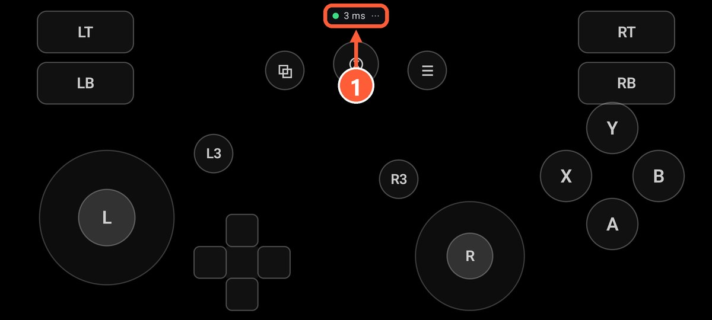
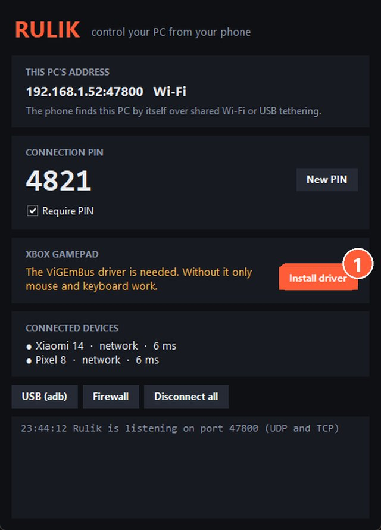

## How it works

Through the ViGEmBus driver, Rulik Server creates a virtual Xbox 360 gamepad in Windows. To the system it's as if you plugged a real gamepad into USB. That's why it doesn't matter where the game came from: Steam, Epic, GOG, the Xbox app, a disc or anywhere else. There's nothing else to install or set up in Windows.

## How to play

1. Connect your phone and start a layout with gamepad buttons, such as "Xbox gamepad", **before** launching the game. Some games only look for a gamepad at startup.
2. In the game's control settings, pick gamepad or controller. Many games switch on their own as soon as you move a stick.
3. On-screen prompts will change to Xbox buttons: A, B, X, Y. That means it works.

1 Green dot and ping: the PC is connected

Buttons in an awkward spot, or one missing? Change the layout in the [editor](editor.html): you can move everything around on the phone without touching the game's own bindings.

## Testing without a game

Press Win+R and type `joy.cpl`. You should see "Controller (XBOX 360 For Windows)", and under Properties you can watch the buttons and sticks react.

> No gamepad in the list? The ViGEmBus driver isn't installed: press "Install driver" in the server window and restart the server. Mouse and keyboard work without the driver.

1 Install driver

## If the game doesn't see the gamepad

- Restart the game with the phone already connected.
- Check that the game supports gamepads at all. If not, read [Games without gamepad support](no-gamepad.html).
- If the game runs through Steam and the gamepad acts strange, try turning off Steam Input for that game: Properties → Controller.
