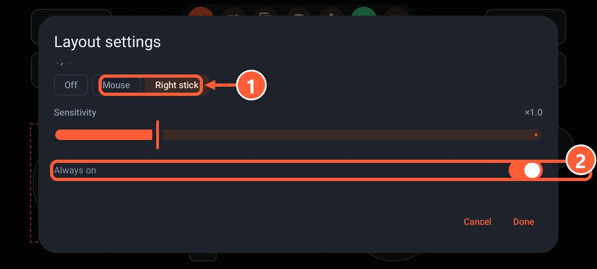
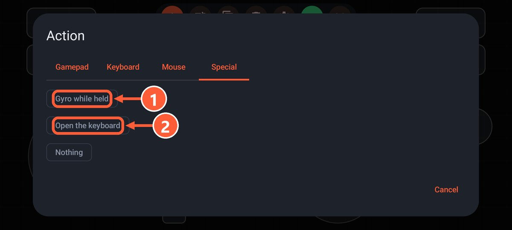

## Gyro aiming

Turning the phone moves the mouse or the right stick, like aiming on a Switch.

1. Open the [editor](editor.html) and tap the gear.
2. Under Gyro, pick what it moves: the mouse or the right stick.
3. Leave "Always on" enabled for constant gyro, or turn it off so the gyro only works while a button is held.

In the second case, add a button with the "Gyro while held" action (Special tab). This is the most comfortable setup: aim roughly with the stick and fine-tune by turning the phone.

1 What the gyro moves: the mouse or the right stick
2 Always on, or only while a button is held

1 The "Gyro while held" action on the Special tab

Axis going the wrong way? Turn on "Invert horizontal" or "Invert vertical". The "Gamepad + gyro aim" layout has it ready to go.

## Tilt steering

Turn on "Steering wheel by tilting (left stick)" in the layout settings. Tilting the phone left and right moves the left stick, and "Full turn angle" sets how far you need to tilt for full lock.

Ready-made layout: "Racing: tilt steering", with gas and brake on the triggers.

## Rumble

- **From the game**: when the game rumbles the gamepad, the phone vibrates. Turn on vibration in the game's own settings.
- **On press**: a short buzz on every button press. Turn on "Vibrate on press" in the layout settings.
