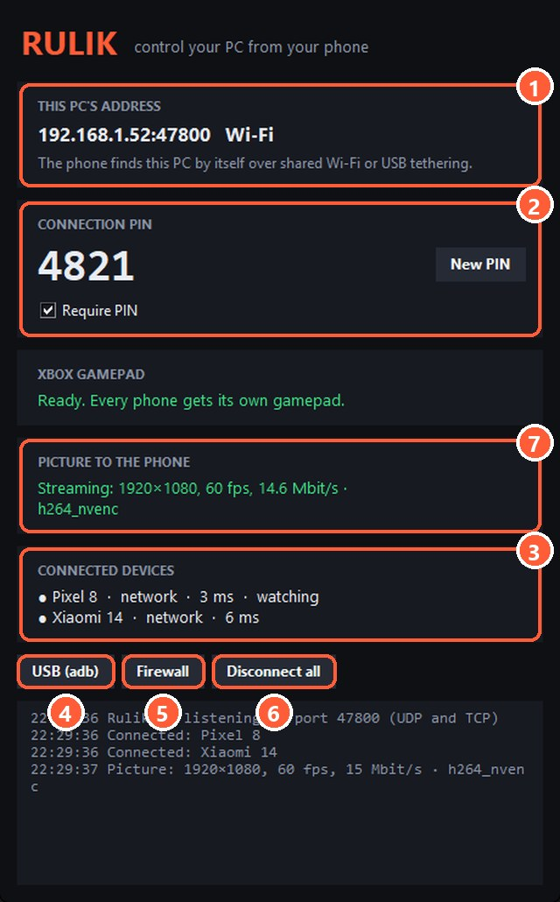
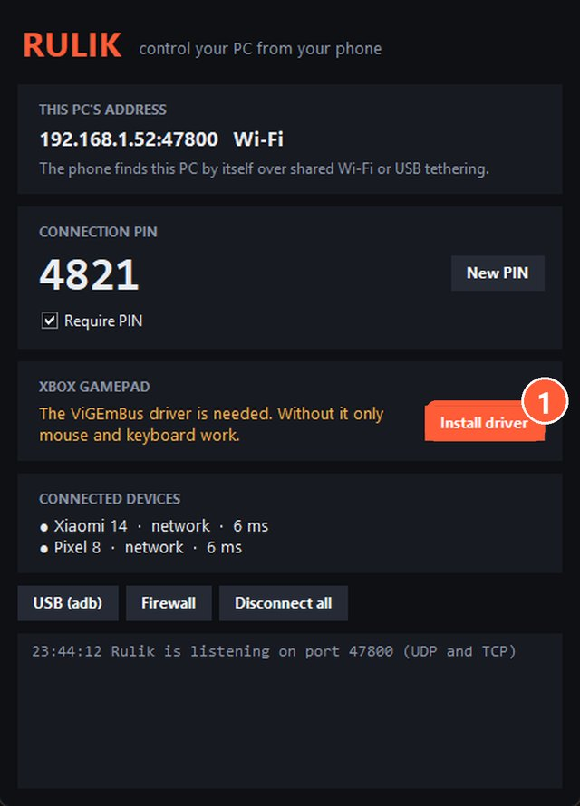
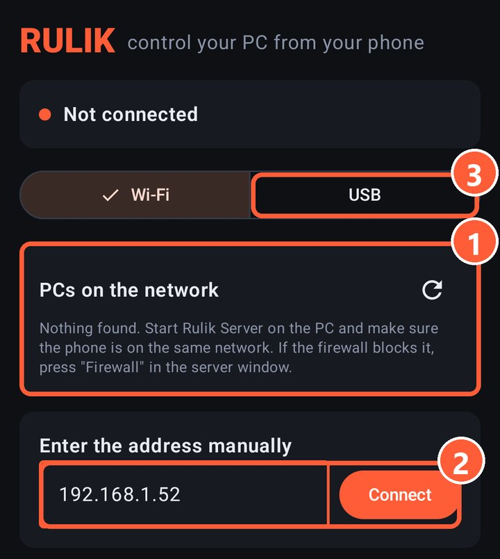
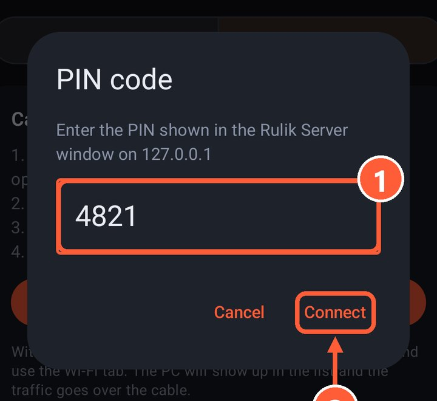
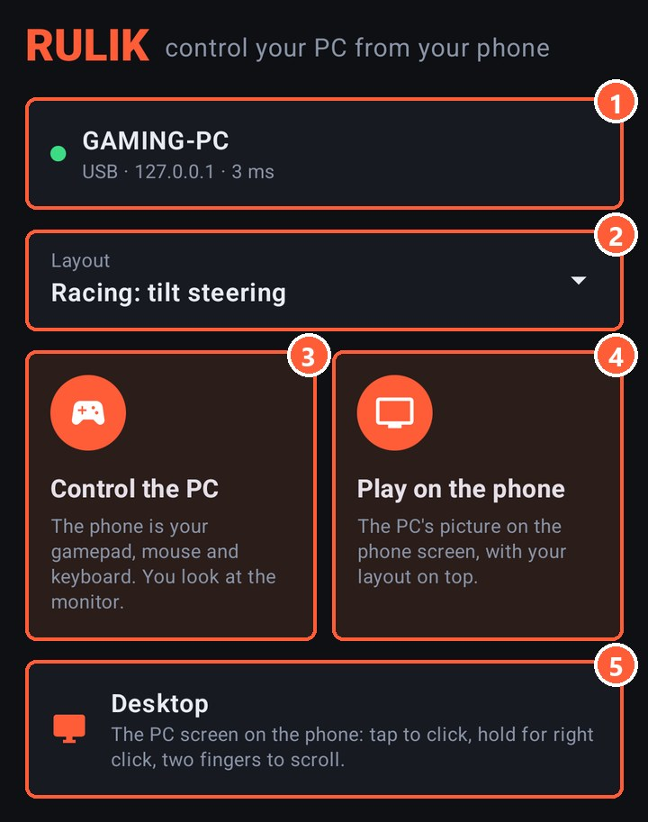

## What you need

- A PC with Windows 10 or 11, 64-bit.
- A phone with Android 10 or newer.
- A shared Wi-Fi network or a USB cable.

## Rulik Server on the PC

Download `rulik-server.exe` from the [Download](../download.html) page and run it. Nothing to install.

- The server window shows the PC's address and a PIN.
- If there's a driver warning, press "Install driver" and restart the server. Without the ViGEmBus driver only mouse and keyboard work.
- When Windows asks about the firewall, allow access on private networks.

1 The PC's address: you can type it into the phone manually
2 Connection PIN and the "New PIN" button
3 Connected phones
4 Cable connection through adb
5 Firewall rule, if the phone can't see the PC
6 Disconnect all phones
7 Picture to the phone: needed to [play on the phone](stream.html)

> Windows SmartScreen warns about an unknown publisher? Click "More info" and "Run anyway": the project doesn't have a paid code signing certificate yet.

1 Press "Install driver", then restart the server

## The app on your phone

Download `rulik.apk` from the [Download](../download.html) page and open the file. Android will ask you to allow installs from your browser or file manager.

## First connection

1. Your PC shows up on the PC tab. Tap it.
2. Enter the PIN from the server window.
3. On the Home tab, pick a layout, for example "Xbox gamepad", and tap "Control the PC".
4. In the game's control settings, pick gamepad.

Want to play looking at the phone instead of the monitor? Tap "Play on the phone", more in [Play on the phone](stream.html).

1 PCs found on the network: tap yours
2 If your PC wasn't found, type the address from the server window and tap Connect
3 Cable connection through adb

1 The PIN from the server window
2 Connect

2 Layout
3 Control the PC: the phone works as a gamepad
4 Play on the phone: the PC's picture on the screen

PC not in the list? See [PC not found](not-found.html). To connect with a cable, use [USB tethering](usb-tether.html) or [adb](adb.html).
