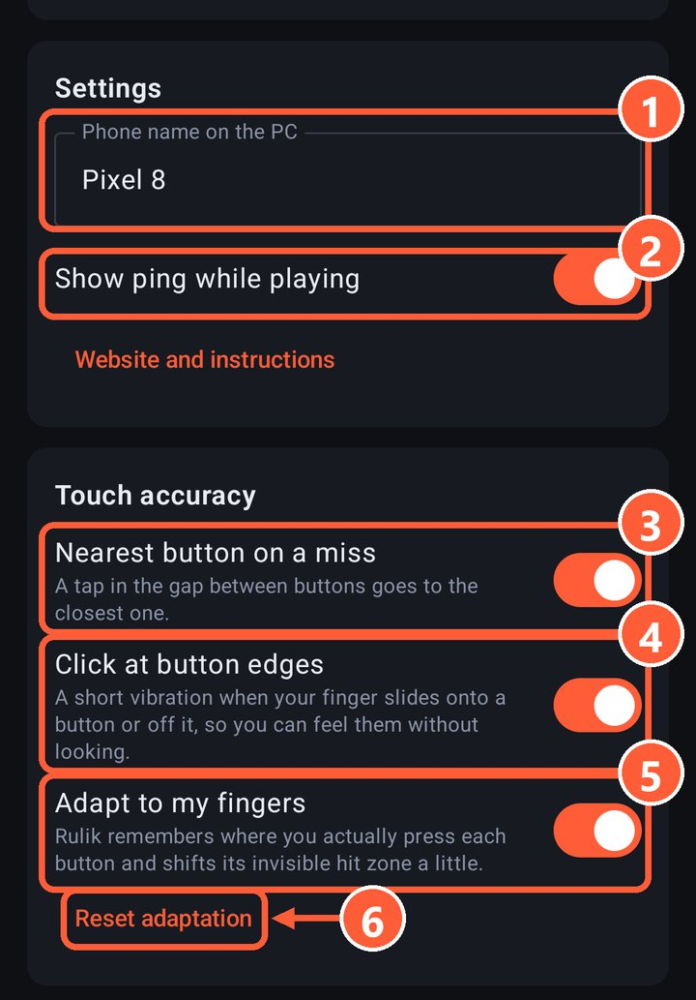
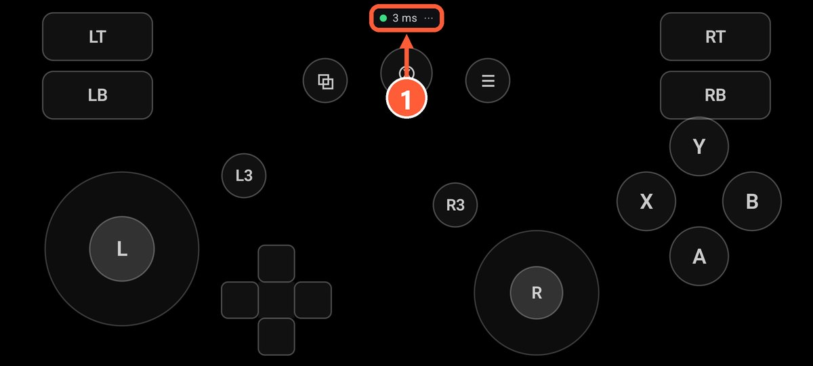

## Check the ping

Turn on "Show ping while playing" in the app's settings. The number shows up in a corner of the screen while you play.

2 Show ping while playing

1 The latency to the PC

- **2–10 ms**: all good.
- **10–30 ms**: playable, but noticeable in fast games.
- **Over 30 ms**: the network is in the way, see the tips below.

## What helps

- Connect the phone to **5 GHz** Wi-Fi and **wire** the PC to the router.
- Try [USB tethering](usb-tether.html): a cable adds almost no latency.
- Turn off **battery saver** on the phone: it slows apps down.
- Close heavy apps and background downloads on the phone.
- Don't sit far from the router.

## If the picture on the phone lags

When you [play on the phone](stream.html), video goes over the network too. If the picture stutters or freezes, lower the bitrate or the resolution: see [picture quality](stream-quality.html).

## Buttons won't get stuck

Even if a packet gets lost on the way, the phone resends the full button state four times a second. So on a bad network a button may react a bit late, but it won't stay pressed.
