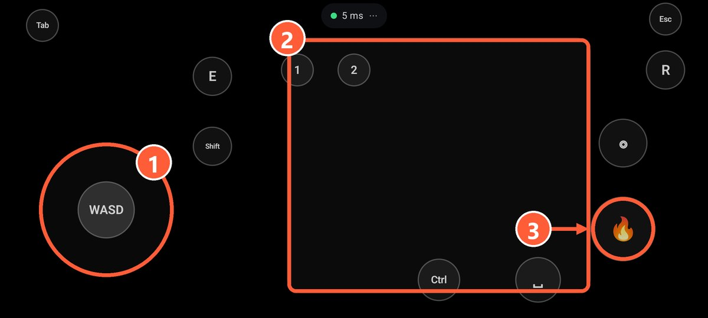
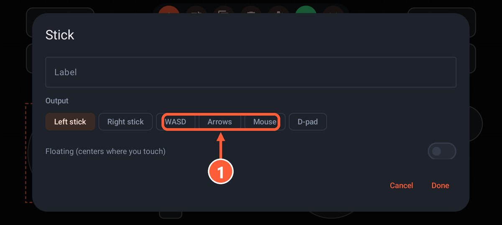
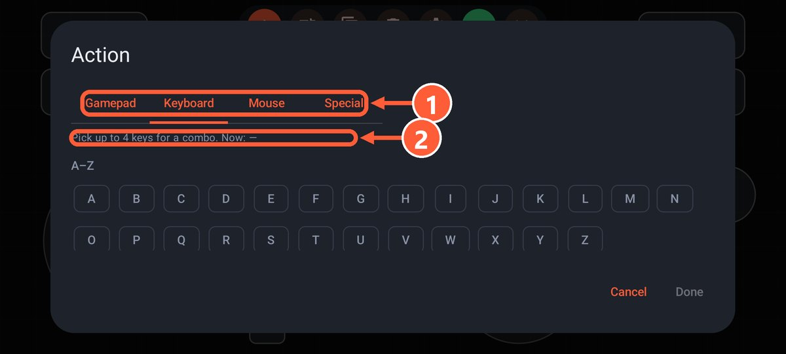

## How it works

Strategy games, older games and many indies don't see gamepads at all. For those you need a layout where phone buttons press keyboard keys and move the mouse. The game thinks you're on a keyboard, and there's no need to pick a gamepad in its settings.

A regular gamepad can't do this on its own: it needs separate tools like reWASD or JoyToKey.

## Making a layout

1. Check the game's settings to see which keys do what.
2. In the app, open Layouts and create a new one, or start from "Shooter: WASD + mouse".
3. Add a **stick** and set it to "WASD" or "Arrows" in its properties: that's movement.
4. Add a **touchpad** in "Mouse" mode: that's the camera or the cursor.
5. Add **buttons** and give each one a game key on the Keyboard or Mouse tab: space, Shift, E, numbers, clicks. You can also set a combo of up to 4 keys.
6. Save, press ▶ and launch the game.

1 Stick in WASD mode: walking
2 Touchpad in mouse mode: camera
3 A button with a left click: shooting

1 Pick WASD or Arrows

1 The Keyboard or Mouse tab
2 Up to 4 keys in one combo

Ready-made layouts for specific games are on the [Layouts](../layouts.html) page, Minecraft for example.

## Mixing is fine

One layout can have both gamepad buttons and keys. For example, in a game with gamepad support you can put F5 for quicksave or Esc on a separate button.

## With a regular gamepad

If you have a real gamepad and the game doesn't support it, you can map its buttons to keys:

- **Steam Input**: in the game's controller settings, bind keys and the mouse to buttons and sticks.
- **Outside Steam**: AntiMicroX (free and open source), JoyToKey or reWASD (paid).

More about real gamepads in [How gamepads work](gamepads.html).
