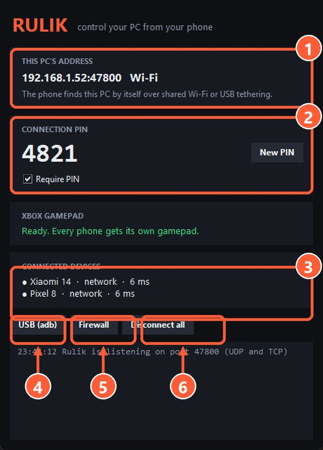

## Is the server running?

"PC is not responding. Is Rulik Server running?" means the phone got no answer. Check that the Rulik Server window is open and wasn't closed by accident.

## Same network

The phone and the PC must be on the same network. Common traps:

- The phone is on the router's **guest network**, which is deliberately isolated from other devices.
- The phone switched to **mobile data** because Wi-Fi is weak.
- A **VPN** is on on the PC or the phone and routes traffic around the local network.
- Some routers have **client isolation** (AP isolation) turned on. You can turn it off in the router settings.

## Firewall

Press "Firewall" in the server window: it adds a rule for port 47800 for every network type. This matters most when Windows thinks your network is public, which happens with [USB tethering](usb-tether.html) and new networks.

If you have a third-party antivirus with its own firewall, allow Rulik Server there too.

## Entering the address manually

Some routers block automatic discovery. Tap "Enter the address manually" and type the address from the server window. The server lists every address of the PC and labels which network each one belongs to.

1 The PC's address
5 The "Firewall" button

## Wrong PIN

The PIN is shown in the server window. If it was changed, enter the new one.

## Nothing helped

Connect with a cable: [USB tethering](usb-tether.html) or [adb](adb.html). If that doesn't work either, describe the problem in a [GitHub issue](https://github.com/Wandraker/rulik/issues).
