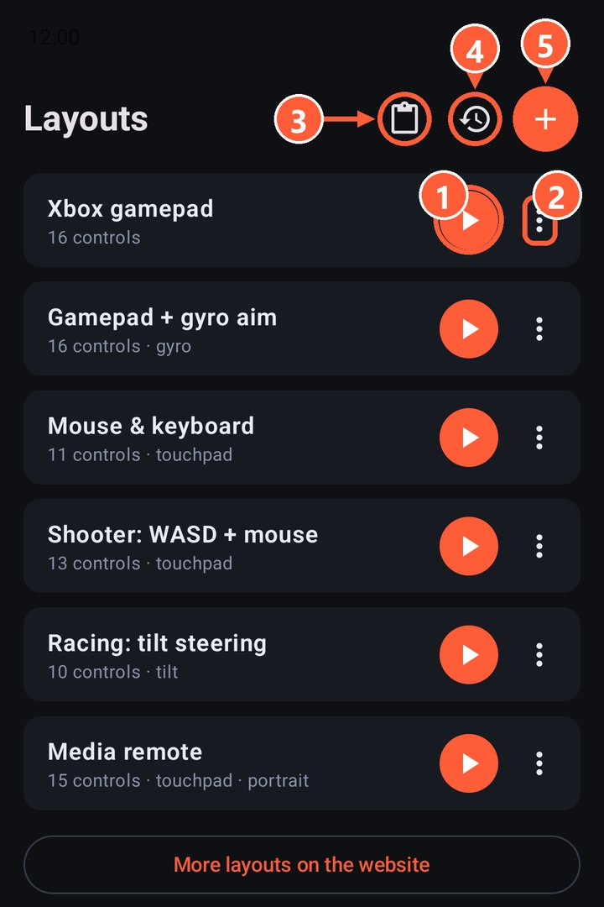
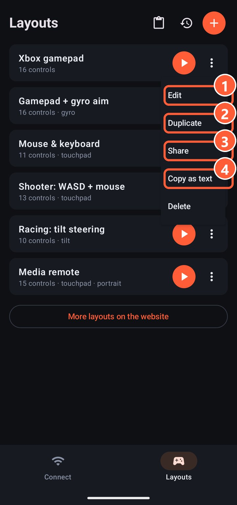

## Built-in layouts

| Layout | What it's for |
|---|---|
| Xbox gamepad | A full gamepad: two sticks, D-pad, ABXY, triggers, bumpers |
| Gamepad + gyro aim | The same, plus aiming by turning the phone |
| Mouse & keyboard | A touchpad, keys and typing for using the PC |
| Shooter: WASD + mouse | For keyboard-and-mouse games: walk with a stick, look with the touchpad |
| Racing: tilt steering | Steer by tilting the phone, gas and brake on the triggers |
| Media remote | A portrait remote for movies: touchpad, volume, pause, tracks, seeking |

Deleted or broke a built-in one? The layouts list has "Restore built-in layouts".

1 Start a layout
2 Layout menu
3 Import a layout from the clipboard
4 Restore built-in layouts
5 New empty layout

## What you can do with a layout

Tap ⋮ next to a layout:

- **Edit**: opens the [editor](editor.html).
- **Duplicate**: makes a copy so you can change it without touching the original.
- **Share**: sends the layout as text to any messenger.
- **Copy as text**: puts the layout on the clipboard.
- **Delete**.

1 Edit
2 Duplicate
3 Share
4 Copy as text

## Import

Copy a layout's text (from a friend or from the [Layouts](../layouts.html) page) and tap "Import from clipboard" in the layouts list.

Made a good layout? Post it in a [GitHub issue](https://github.com/Wandraker/rulik/issues/new?title=Layout:%20) and it may make it into the catalog on the website.
