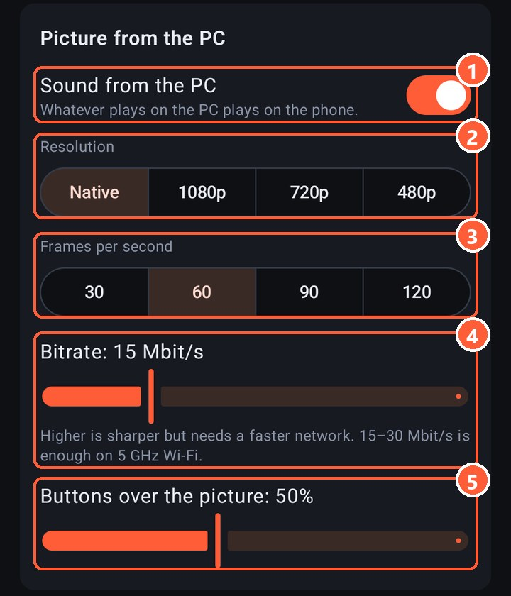

1 Sound from the PC on the phone
2 Picture resolution
3 Frames per second
4 Bitrate: how much data goes over the network per second
5 How visible the layout buttons are over the game

## What to pick

| Network | Resolution | Frames | Bitrate |
|---|---|---|---|
| Cable (USB tethering) | Native | 60 | 30–50 Mbit/s |
| 5 GHz Wi-Fi near the router | Native or 1080p | 60 | 15–30 Mbit/s |
| 2.4 GHz Wi-Fi or through a wall | 720p | 60 | 6–10 Mbit/s |
| A really bad network | 480p | 30 | 3–5 Mbit/s |

"Native" means the same as the PC's monitor. A phone screen is small, so 1080p and 1440p look almost the same on it, and 1080p is much easier on the network.

You can't get more frames than the PC's monitor shows: with a 60 Hz monitor the server caps the stream at 60. 90 and 120 make sense with a 120 Hz or faster monitor. While you play, Rulik switches the phone's screen to its highest refresh rate so frames don't wait.

> Over a cable, turn on USB tethering on the phone rather than using adb. Through adb frames arrive in bunches, through USB tethering they arrive evenly, with a 1–4 ms ping.

## Latency

The total is the network delay ([ping](lag.html)), compression on the graphics card (a few milliseconds) and decoding on the phone. If the ping is turned on in the settings, the corner shows how many milliseconds a frame took from arrival to the screen. All together it's usually 20–40 ms over 5 GHz Wi-Fi and less over a cable.

The same things help as with [lag](lag.html): 5 GHz, the PC wired to the router, battery saver off.

## Blocks and freezes

If a packet with part of a frame gets lost, the phone doesn't show a broken picture: it waits for the next whole frame. That can take up to a second. If it freezes often, the network can't carry that bitrate: lower it.

## Sound

The phone plays everything the PC plays: the game, music, notifications. The sound is uncompressed, about 3 Mbit/s. If you don't need it, turn off "Sound from the PC" to make the network lighter.
