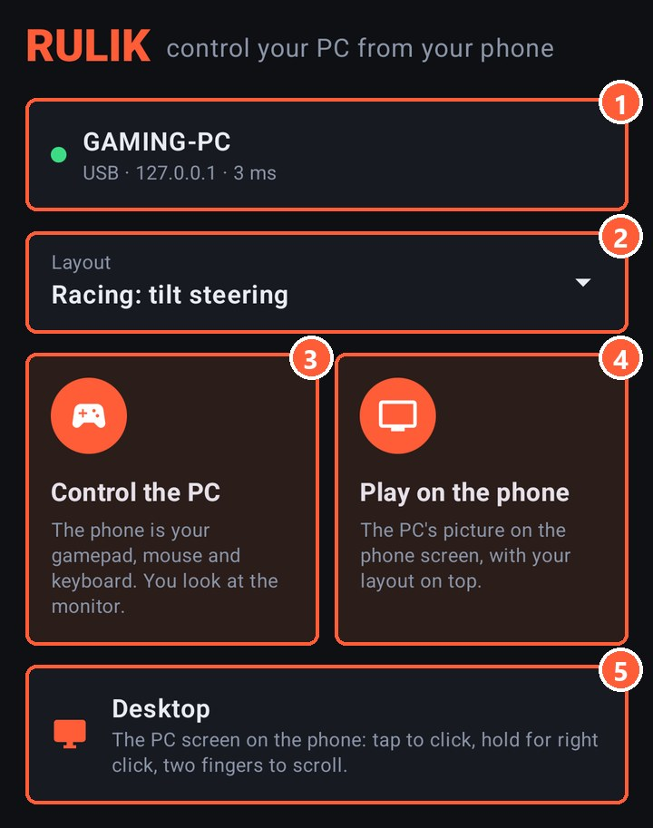
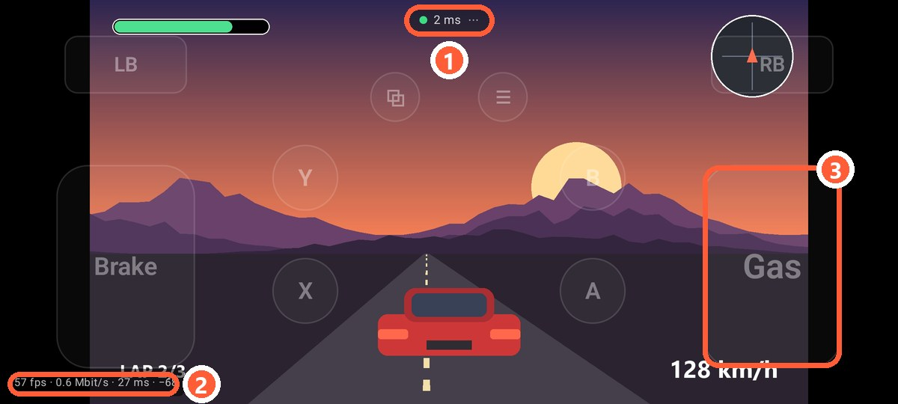
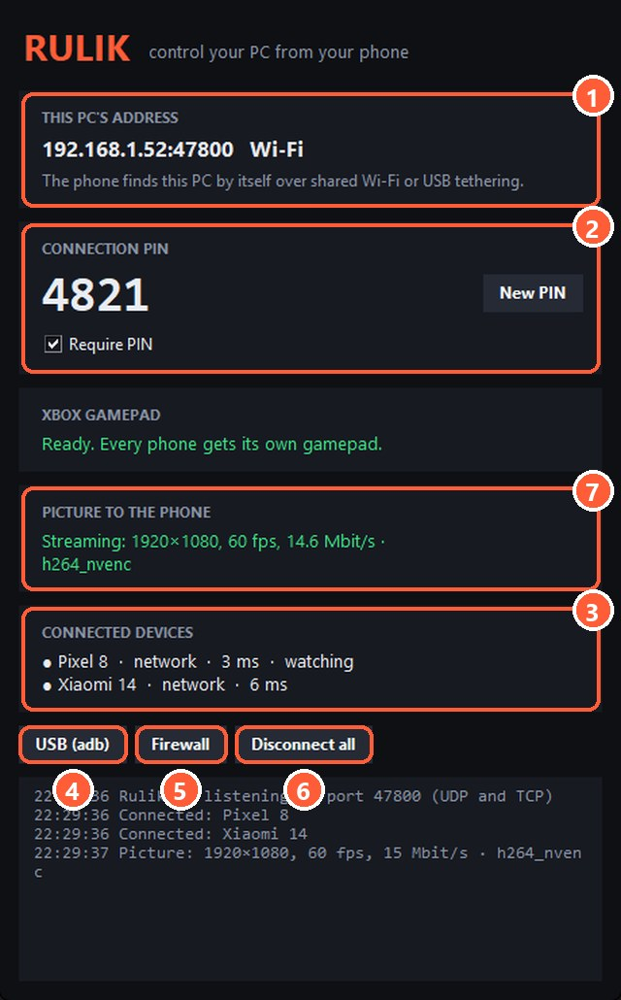

## How it works

The PC captures its screen, compresses it on the graphics card and sends it to the phone together with the sound. The phone shows the picture and draws your layout on top of it. Presses go to the PC the same way as in the normal mode, so every layout works: gamepad, keyboard, mouse, gyro.

The game itself runs on the PC, and the phone only shows the video. So the phone can play any game your PC can run.

## How to turn it on

1. Connect the phone to the PC as usual: over [Wi-Fi](wifi.html) or a [cable](usb-tether.html).
2. Pick a layout on the home screen.
3. Tap "Play on the phone".

1 The PC you're connected to. Tap it to change
2 The layout you'll play with
3 The normal mode: the phone is a gamepad, you look at the monitor
4 The PC's picture on the phone, the layout on top
5 [Desktop](desktop.html): the PC screen you control with your finger

1 Ping and the menu: keyboard, layout editor, exit
2 Frames per second, stream speed and decoding delay. Shown when the ping is turned on in the settings
3 Layout buttons are see-through so they don't hide the game

The picture is always landscape in this mode, even if the layout was made for portrait.

## What the PC needs

- **Rulik Server 0.3.0 or newer.** An older server doesn't send the picture, and the app tells you so.
- **ffmpeg.** The server uses it to capture the screen and compress the video. If it's missing, the server window shows a "Download ffmpeg" button: about 100 MB, once.
- **A graphics card that can compress video.** Almost any from the last 10 years will do: NVIDIA (NVENC), AMD (AMF), Intel (Quick Sync). Without one the server compresses on the processor, which is slower.

7 Status: size, frames, stream speed and what compresses the video
3 A phone that watches the screen is marked "watching"

## Several phones

Several phones can watch at once, and they all get the same picture. If two phones ask for different quality, the one that asked last wins.

## If it doesn't work

- **"Waiting for the picture from the PC…" and nothing happens.** Check the server window: if ffmpeg couldn't start, its error is there.
- **Black screen in a game.** Some games in exclusive fullscreen don't let themselves be captured. Switch the game to "borderless window".
- **Stutters or breaks up.** See [picture quality](stream-quality.html): lower the bitrate or the resolution.
