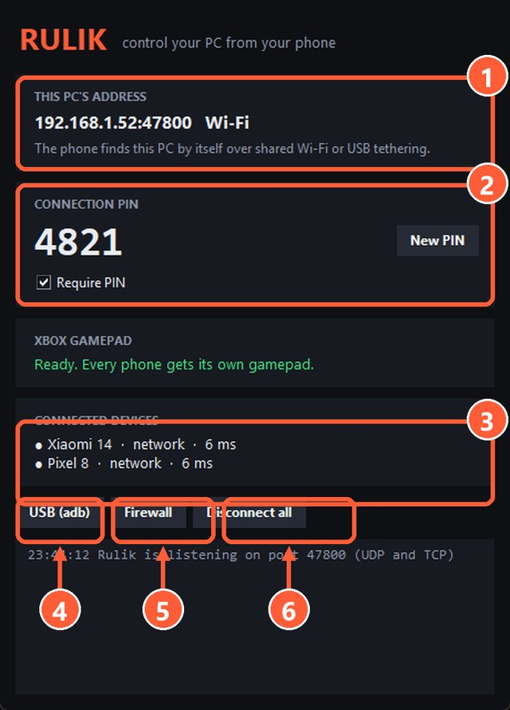

## How to connect

1. Connect the phone to the PC with a cable.
2. In Android settings, turn on "USB tethering" (usually under Hotspot & tethering).
3. In the app, stay on the Wi-Fi tab: the PC shows up in the list, and the traffic goes over the cable.

## Firewall

Windows marks the phone's network as public and blocks incoming connections from it by default. The server detects this and shows a warning.

> Press "Firewall" in the server window once: the rule works for all networks.

5 "Firewall" adds a rule for port 47800 on all networks

## No new network appeared

If no new network shows up in Windows after you turn on tethering, open Device Manager. The phone should appear as "Remote NDIS based Internet Sharing Device".

- Try another cable: some cables only charge and don't carry data.
- Try another USB port, ideally one right on the motherboard.

Still no luck? Connect [via adb](adb.html).
