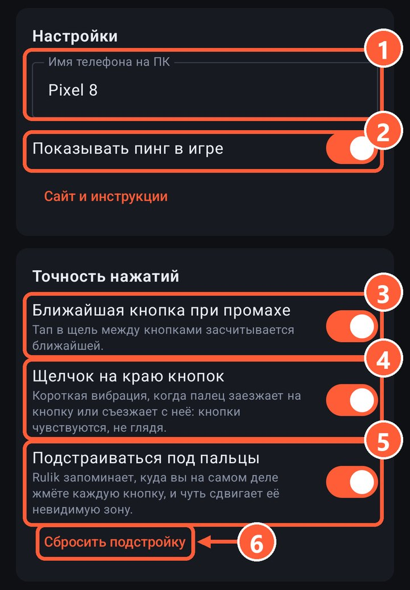

Все три настройки лежат в приложении на вкладке «Настройки», блок «Точность нажатий». По умолчанию все включены, каждую можно выключить отдельно.

3 Ближайшая кнопка при промахе
4 Щелчок на краю кнопок
5 Подстройка под пальцы
6 Сбросить подстройку

## Ближайшая кнопка при промахе

Тап в щель между кнопками засчитывается ближайшей кнопке или крестовине, если она в пределах половины пальца. Если вокруг пусто, ничего не нажимается.

Нажатие по самой кнопке всегда остаётся её нажатием: подстройка срабатывает только на промахах. Стики и тачпады промахи не притягивают, чтобы случайно не дёрнуть камеру.

## Щелчок на краю кнопок

Короткая вибрация, когда палец съезжает с кнопки или заезжает на соседнюю. Так кнопки находятся на ощупь, не глядя на экран. Щелчок работает, даже если в раскладке выключена «Вибрация при нажатии».

## Подстройка под пальцы

Большой палец почти всегда попадает не в центр кнопки, а чуть ниже и ближе к ладони. Rulik запоминает, куда вы на самом деле жмёте каждую кнопку, и после первых 8 нажатий слегка сдвигает её невидимую зону в ту сторону.

- Сдвиг небольшой, не больше 40% от размера кнопки.
- Нарисованная соседняя кнопка всегда важнее сдвинутой зоны.
- У каждой раскладки своя подстройка.

Поменяли хват или отдали телефон другому человеку? Нажмите «Сбросить подстройку», и Rulik начнёт учиться заново.

## Если всё равно промахиваетесь

Сделайте кнопку больше или отодвиньте её в [редакторе](editor.html). Удобнее всего, когда кнопки под большими пальцами крупные, а редкие кнопки мелкие и подальше.
