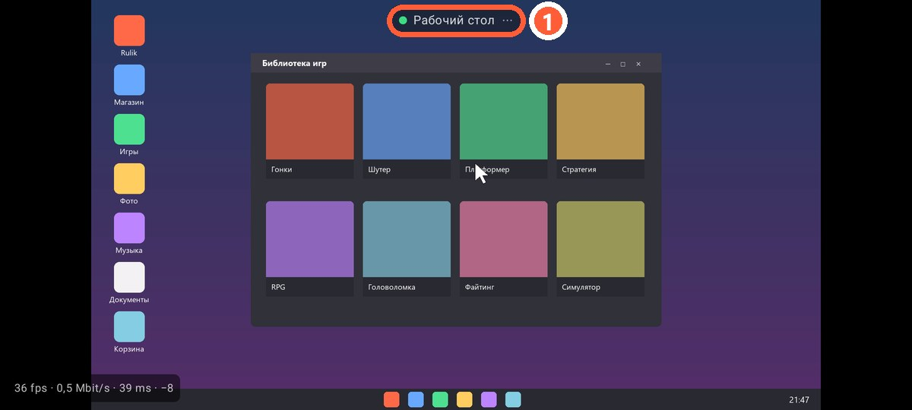

## Как открыть

На главном экране приложения нажмите «Рабочий стол». Нужен тот же Rulik Server 0.3.0 с ffmpeg, что и для [игры на телефоне](stream.html).

1 Меню: клавиатура и выход

## Жесты

| Жест | Что делает |
|---|---|
| Касание | Левый клик в этом месте |
| Удержание полсекунды | Правый клик, телефон коротко вибрирует |
| Провести пальцем | Перетаскивание с зажатой левой кнопкой: выделить, перенести окно |
| Два пальца вверх или вниз | Прокрутка колесом |
| Касание двумя пальцами | Правый клик |

Курсор прыгает туда, где вы коснулись: это не тачпад, палец попадает прямо в точку на экране.

## Текст

В меню сверху есть «Клавиатура»: всё, что набираете на телефоне, сразу печатается на ПК. Там же есть Enter, Backspace, Tab и Esc.

## Несколько мониторов

Показывается основной монитор Windows. Если нужен другой, сделайте его основным в параметрах экрана Windows.
