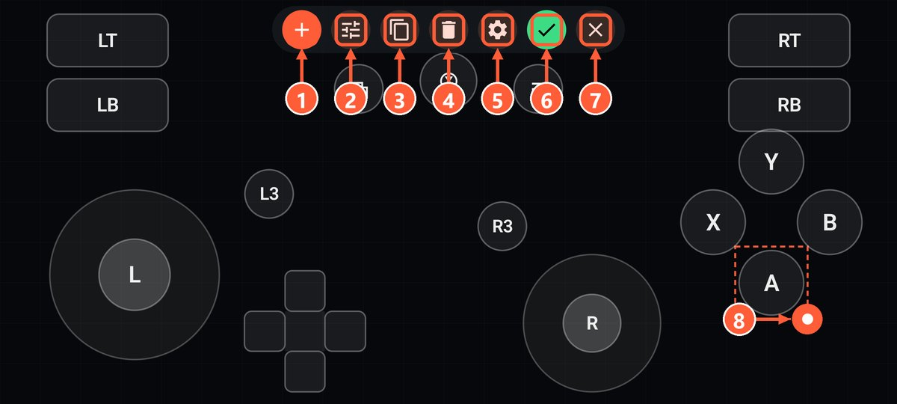
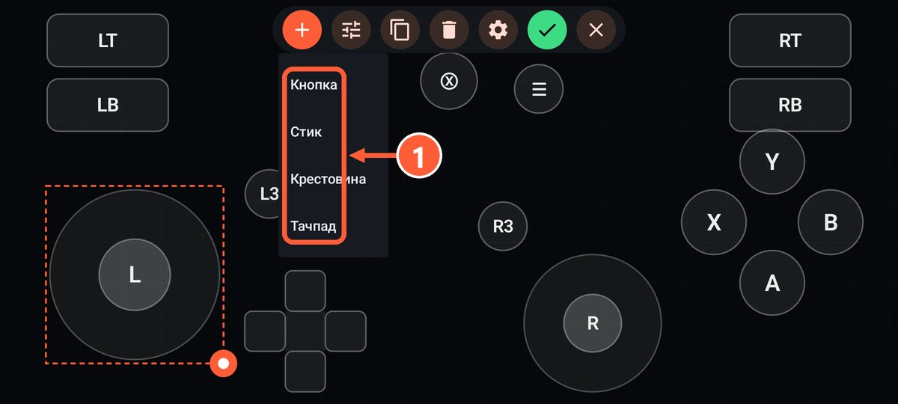
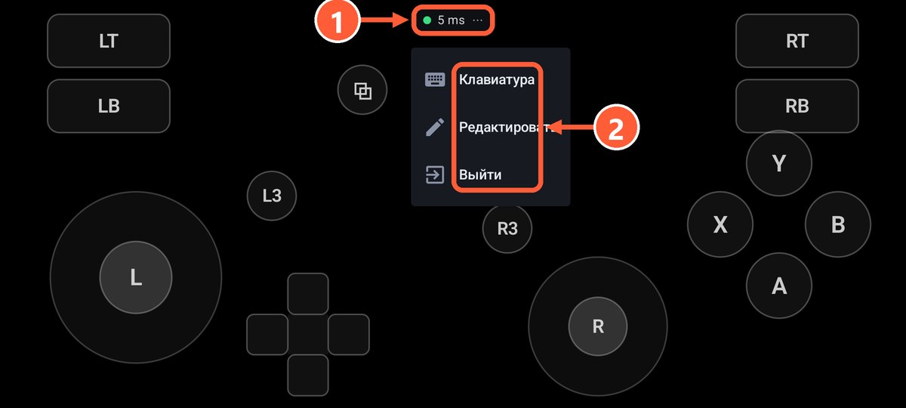
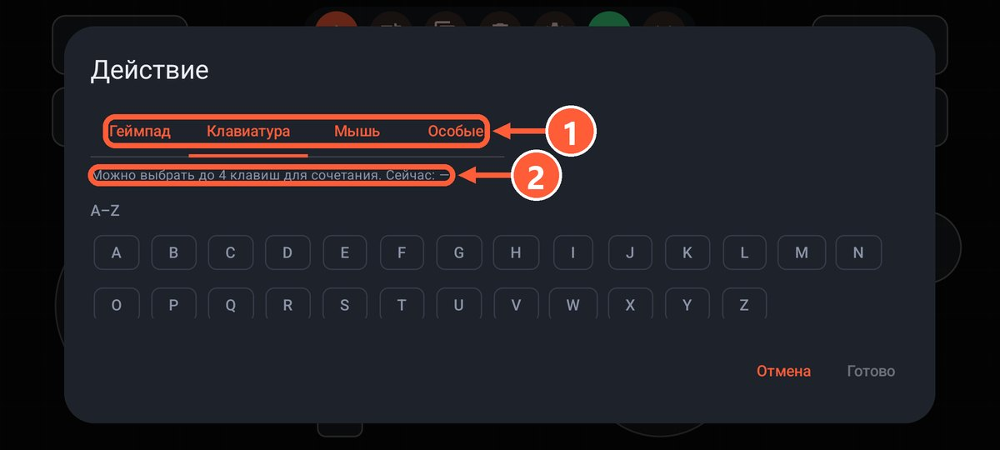
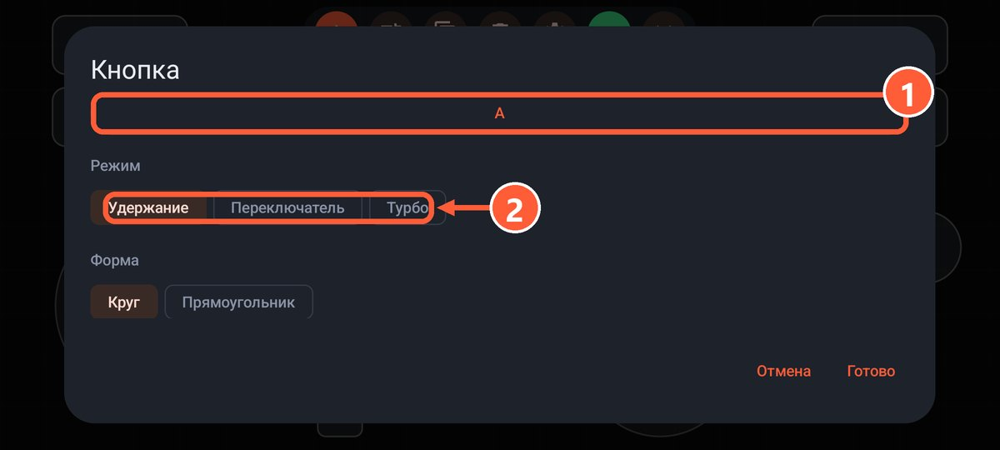
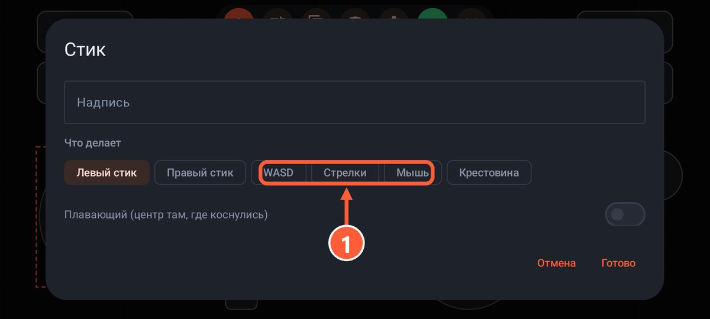
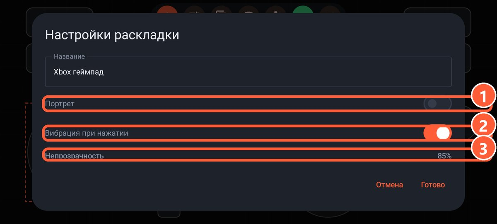

## Как открыть

В списке раскладок нажмите ⋮ и «Редактировать». Прямо в игре редактор открывается кнопкой «⋯».

- **+** добавляет кнопку, стик, крестовину или тачпад.
- Элемент двигается пальцем, размер меняется за кружок в углу.
- Кнопка с ползунками открывает свойства элемента.
- Шестерёнка открывает настройки всей раскладки.

1 Добавить элемент
2 Свойства выделенного элемента
3 Дублировать элемент
4 Удалить элемент
5 Настройки раскладки
6 Сохранить
7 Выйти без сохранения
8 Потяните кружок, чтобы изменить размер

1 Кнопка, стик, крестовина или тачпад

1 Нажмите на плашку с пингом
2 Набор текста на ПК, редактор раскладки, выход

## Кнопка

**Действие** выбирается на одной из вкладок:

- **Геймпад**: любая кнопка Xbox, курки, бамперы, нажатие стиков.
- **Клавиатура**: любая клавиша или сочетание до 4 клавиш, например Ctrl+Shift+Esc.
- **Мышь**: левая, правая, средняя, боковые кнопки, колесо вверх и вниз.
- **Особые**: «Гироскоп, пока зажато» и «Открыть клавиатуру» для набора текста на ПК.

1 Вкладки: геймпад, клавиатура, мышь, особые
2 Выбранное сочетание: можно отметить до 4 клавиш

**Режим**:

- **Удержание**: нажата, пока держите палец.
- **Переключатель**: первое нажатие зажимает, второе отпускает. Удобно для бега или прицела.
- **Турбо**: пока держите, кнопка жмётся много раз в секунду. Скорость настраивается.

Ещё у кнопки есть надпись и форма: круг или прямоугольник.

1 Действие: нажмите, чтобы выбрать
2 Режим: удержание, переключатель или турбо

## Стик

**Что делает**: левый стик, правый стик, WASD, стрелки, крестовина или мышь.

- **Плавающий**: центр стика появляется там, где вы коснулись. Не нужно попадать пальцем точно.
- **Мёртвая зона**: насколько сильно нужно отклонить стик, чтобы он сработал.
- **Чувствительность**: для режима мыши.

1 Что делает стик: левый или правый стик, WASD, стрелки, мышь, крестовина

## Крестовина

Работает как крестовина геймпада, WASD или стрелки.

## Тачпад

- **Мышь**: тап как левый клик, тап двумя пальцами как правый, прокрутка двумя пальцами, тап и удержание для перетаскивания.
- **Камера (правый стик)**: свайп крутит камеру как стиком. Работает в любой игре на геймпаде.

## Настройки раскладки

- **Название**.
- **Портрет**: вертикальная ориентация вместо горизонтальной.
- **Вибрация при нажатии**.
- **Непрозрачность** кнопок: чтобы не мешали смотреть на экран.
- **Гироскоп** и **Наклон**: смотрите [Гироскоп, наклон и вибрация](gyro.html).

1 Вертикальная ориентация
2 Вибрация при нажатии
3 Непрозрачность кнопок
