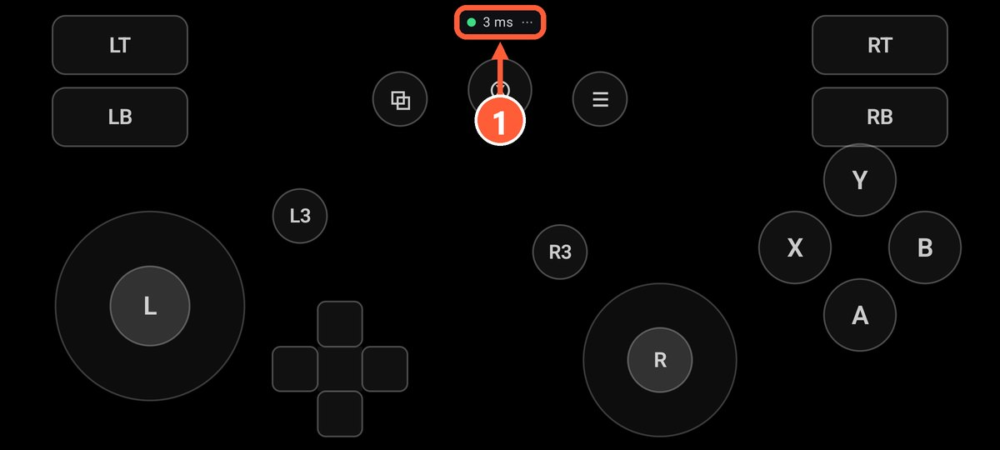
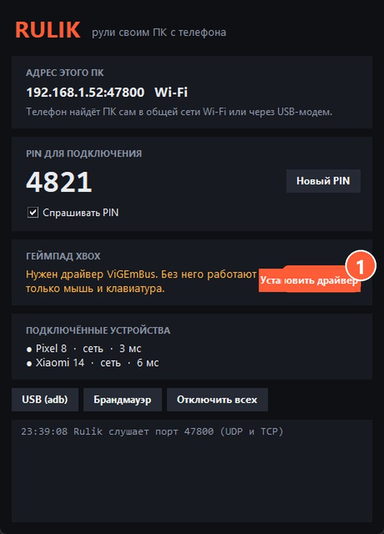

## Как это работает

Rulik Server через драйвер ViGEmBus создаёт в Windows виртуальный геймпад Xbox 360. Для системы это как будто вы воткнули настоящий геймпад в USB. Поэтому неважно, откуда игра: Steam, Epic, GOG, Xbox app, диск или что-то ещё. Отдельно в Windows ничего ставить и настраивать не нужно.

## Как играть

1. Подключите телефон и запустите раскладку с кнопками геймпада, например «Xbox геймпад», **до** запуска игры. Некоторые игры ищут геймпад только при старте.
2. В игре откройте настройки управления и выберите геймпад или контроллер. Многие игры переключаются сами, как только вы тронете стик.
3. Подсказки на экране сменятся на кнопки Xbox: A, B, X, Y. Значит, всё работает.

1 Зелёная точка и пинг: связь с ПК есть

Кнопки неудобно расположены или не хватает кнопки? Поменяйте раскладку в [редакторе](editor.html): на телефоне можно переставить всё, а назначения кнопок в самой игре менять не нужно.

## Проверка без игры

Нажмите Win+R и введите `joy.cpl`. В списке должен быть «Controller (XBOX 360 For Windows)», а в «Свойствах» видно, как реагируют кнопки и стики.

> Геймпада нет в списке? Значит, не стоит драйвер ViGEmBus: нажмите «Установить драйвер» в окне сервера и перезапустите его. Мышь и клавиатура работают и без драйвера.

1 Установить драйвер

## Если игра не видит геймпад

- Перезапустите игру с уже подключённым телефоном.
- Проверьте, что игра вообще поддерживает геймпад. Если нет, читайте [Игры без поддержки геймпада](no-gamepad.html).
- Если игра запущена через Steam и геймпад ведёт себя странно, попробуйте выключить Steam Input для этой игры: «Свойства» → «Контроллер».
