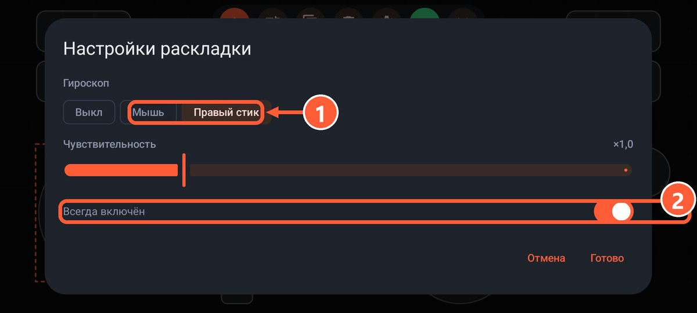
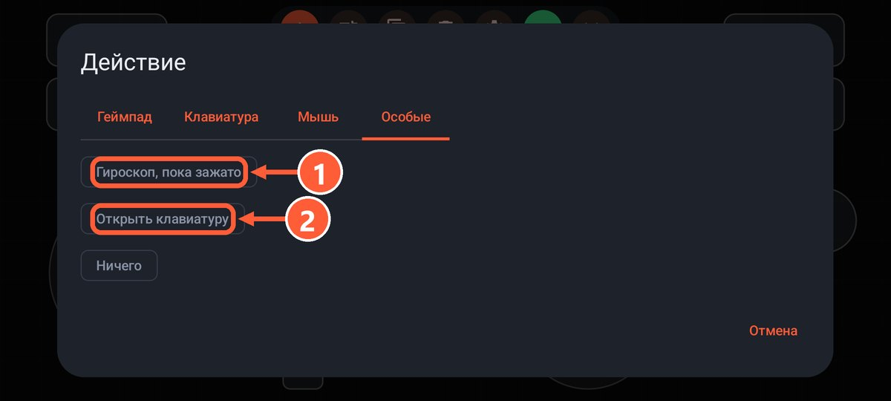

## Гироприцел

Поворот телефона двигает мышь или правый стик, как прицеливание на Switch.

1. Откройте [редактор](editor.html) и нажмите шестерёнку.
2. В пункте «Гироскоп» выберите, что он двигает: мышь или правый стик.
3. Переключатель «Всегда включён» оставьте, чтобы гироскоп работал постоянно, или выключите, чтобы он работал только пока зажата кнопка.

Во втором случае добавьте кнопку с действием «Гироскоп, пока зажато» (вкладка «Особые»). Так удобнее всего: грубо целитесь стиком, а точно доводите поворотом телефона.

1 Что двигает гироскоп: мышь или правый стик
2 Работать постоянно или только пока зажата кнопка

1 Действие «Гироскоп, пока зажато» на вкладке «Особые»

Ось ушла не туда? Включите «Инвертировать по горизонтали» или «по вертикали». Готовый вариант есть в раскладке «Геймпад + гироприцел».

## Руль наклоном

Включите «Руль наклоном (левый стик)» в настройках раскладки. Наклон телефона влево и вправо поворачивает левый стик, а «Угол полного поворота» задаёт, насколько сильно нужно наклонить для поворота до упора.

Готовая раскладка: «Гонки: руль наклоном», газ и тормоз на курках.

## Вибрация

- **Из игры**: когда игра включает вибрацию геймпада, вибрирует телефон. Включите вибрацию в настройках самой игры.
- **При нажатии**: короткий отклик на каждое нажатие кнопки. Включается в настройках раскладки, пункт «Вибрация при нажатии».
