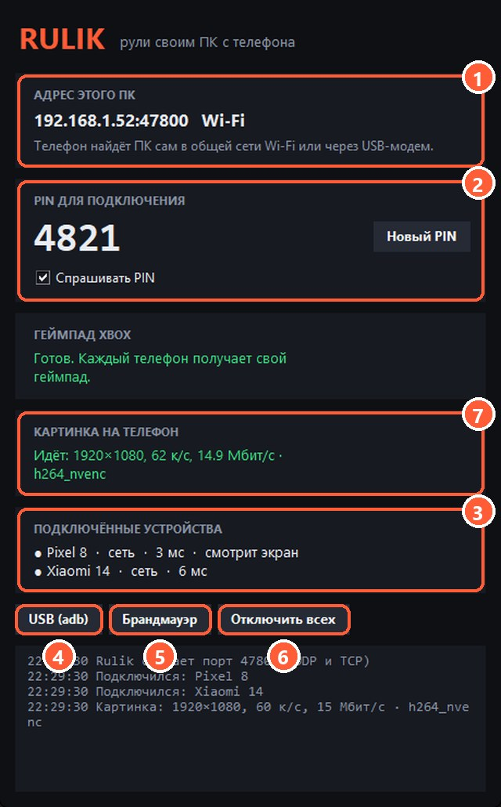
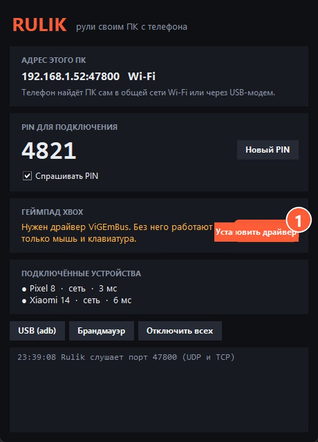
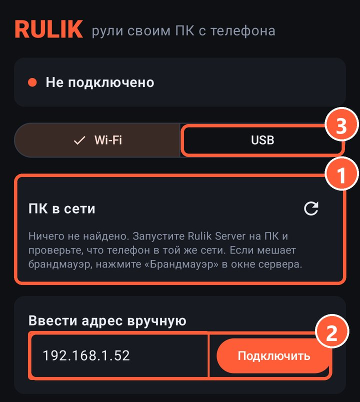
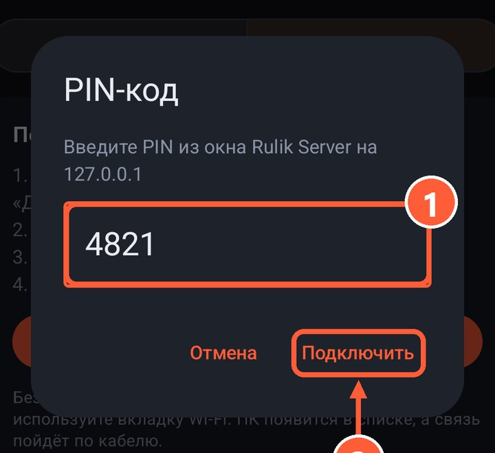
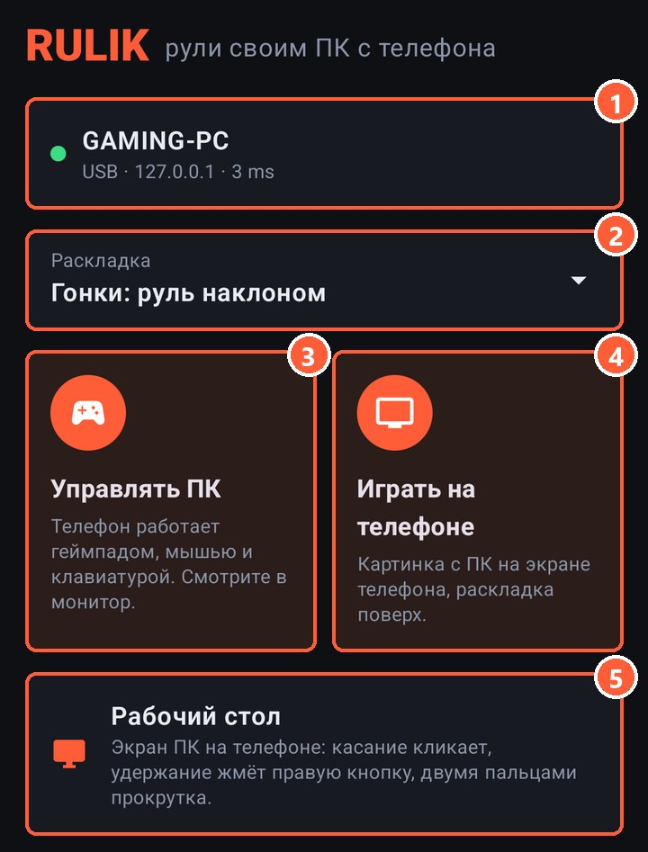

## Что нужно

- ПК с Windows 10 или 11, 64 бита.
- Телефон на Android 10 или новее.
- Общая сеть Wi-Fi или USB-кабель.

## Rulik Server на ПК

Скачайте `rulik-server.exe` на странице [«Скачать»](../download.html) и запустите. Устанавливать ничего не нужно.

- В окне сервера видны адрес ПК и PIN.
- Если стоит предупреждение про драйвер, нажмите «Установить драйвер» и перезапустите сервер. Без драйвера ViGEmBus работают только мышь и клавиатура.
- Когда Windows спросит про брандмауэр, разрешите доступ в частных сетях.

1 Адрес ПК: его можно ввести в телефоне вручную
2 PIN для подключения и кнопка «Новый PIN»
3 Подключённые телефоны
4 Подключение по кабелю через adb
5 Правило брандмауэра, если телефон не видит ПК
6 Отключить все телефоны
7 Картинка на телефон: нужна, чтобы [играть на телефоне](stream.html)

> Windows SmartScreen пишет про неизвестного издателя? Нажмите «Подробнее» и «Выполнить в любом случае»: у проекта пока нет платной подписи кода.

1 Нажмите «Установить драйвер», потом перезапустите сервер

## Приложение на телефон

Скачайте `rulik.apk` на странице [«Скачать»](../download.html) и откройте файл. Android попросит разрешить установку из браузера или файлового менеджера.

## Первое подключение

1. На вкладке «ПК» появится ваш ПК. Нажмите на него.
2. Введите PIN из окна сервера.
3. На вкладке «Главная» выберите раскладку, например «Xbox геймпад», и нажмите «Управлять ПК».
4. В игре в настройках управления выберите геймпад.

Хотите играть, глядя в телефон, а не в монитор? Нажмите «Играть на телефоне», подробнее в статье [Играть на телефоне](stream.html).

1 Найденные в сети ПК: нажмите на свой
2 Если ПК не нашёлся, впишите адрес из окна сервера и нажмите «Подключить»
3 Подключение по кабелю через adb

1 PIN из окна сервера
2 Подключиться

2 Раскладка
3 Управлять ПК: телефон работает геймпадом
4 Играть на телефоне: картинка с ПК на экране

ПК не появился в списке? Смотрите [ПК не находится](not-found.html). Подключиться по кабелю можно через [USB-модем](usb-tether.html) или [adb](adb.html).
