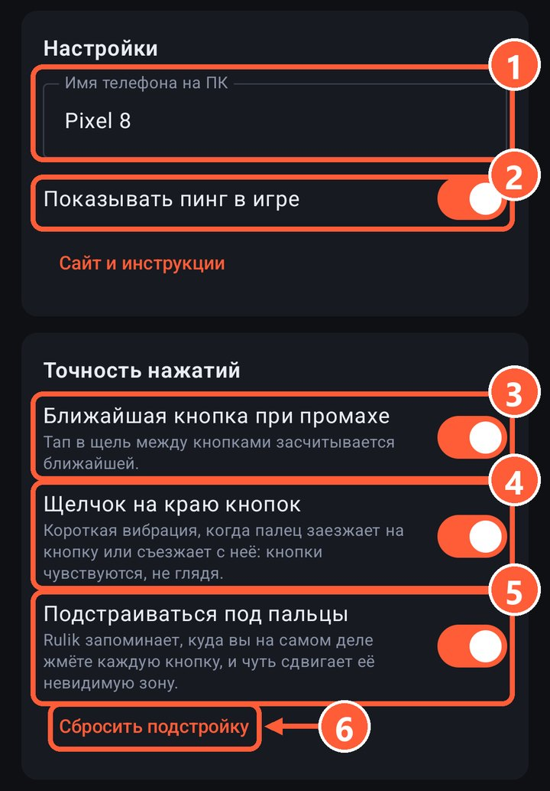
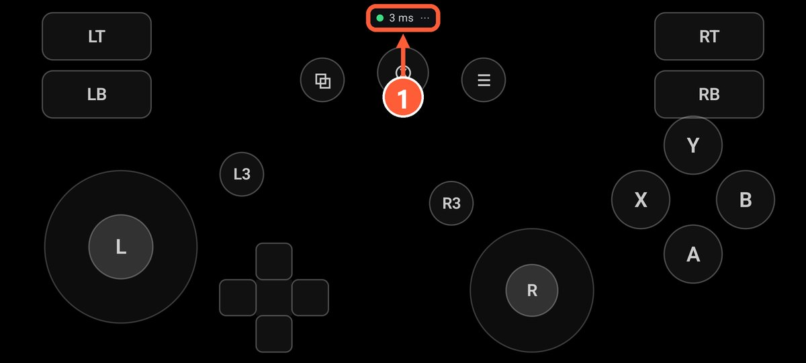

## Посмотрите пинг

Включите в настройках приложения «Показывать пинг в игре». Число появится в углу экрана во время игры.

2 Показывать пинг в игре

1 Здесь задержка до ПК

- **2–10 мс**: всё в порядке.
- **10–30 мс**: играть можно, но в динамичных играх уже заметно.
- **Больше 30 мс**: мешает сеть, смотрите советы ниже.

## Что помогает

- Подключите телефон к Wi-Fi **5 ГГц**, а ПК к роутеру **кабелем**.
- Попробуйте [USB-модем](usb-tether.html): кабель почти не даёт задержки.
- Отключите на телефоне режим **энергосбережения**: он притормаживает приложения.
- Закройте на телефоне тяжёлые приложения и загрузки в фоне.
- Не стойте далеко от роутера.

## Кнопка не залипнет

Даже если пакет потерялся по дороге, телефон четыре раза в секунду досылает полное состояние кнопок. Поэтому при плохой сети кнопка может сработать чуть позже, но не останется зажатой.
