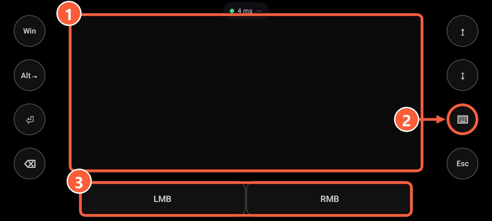
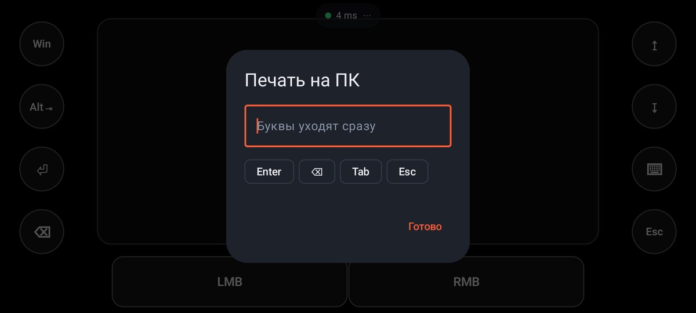

## Тачпад

Раскладка «Мышь и клавиатура» почти целиком состоит из тачпада:

- **Тап**: левый клик.
- **Тап двумя пальцами**: правый клик.
- **Двумя пальцами вверх и вниз**: прокрутка.
- **Тап и удержание**: перетаскивание окон и файлов.

Чувствительность меняется в свойствах тачпада в [редакторе](editor.html).

1 Тачпад
2 Набор текста на ПК
3 Левая и правая кнопки мыши

## Набор текста

Кнопка с действием «Открыть клавиатуру» показывает клавиатуру телефона. Буквы уходят на ПК сразу, по мере набора, так что можно писать в браузере, мессенджере или чате игры.
## Клавиши и сочетания

Любой кнопке можно назначить клавишу или сочетание до 4 клавиш: Alt+Tab, Win, Ctrl+C, медиаклавиши громкости и паузы. Готовый пульт для фильмов есть в раскладке «Медиа-пульт».

> Мышь и клавиатура работают даже без драйвера ViGEmBus: он нужен только для геймпада.
