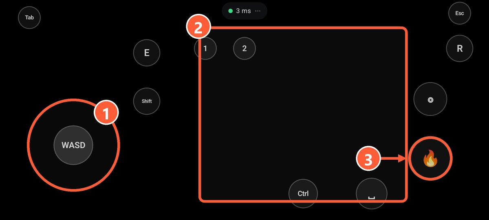
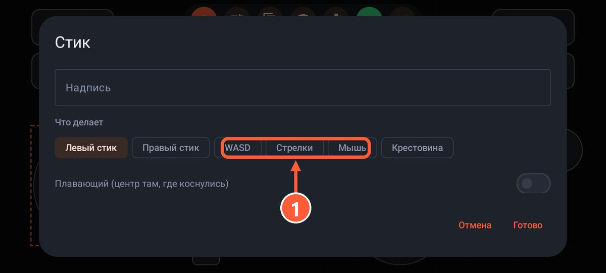
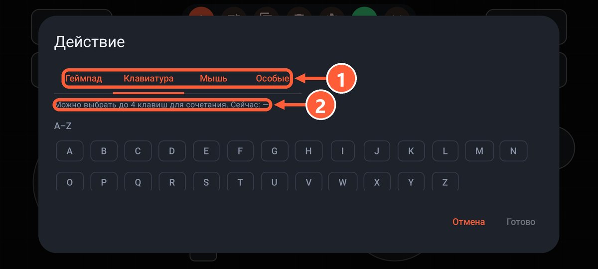

## Как это работает

Стратегии, старые и многие инди-игры не видят геймпад вообще. Тогда нужна раскладка, где кнопки на телефоне жмут клавиши клавиатуры и двигают мышь. Игра будет думать, что вы играете на клавиатуре, и выбирать геймпад в её настройках не нужно.

Обычный геймпад так сам не умеет: ему для этого нужны отдельные программы вроде reWASD или JoyToKey.

## Как сделать раскладку

1. Посмотрите в настройках игры, какие клавиши за что отвечают.
2. В приложении откройте «Раскладки», создайте новую или возьмите за основу «Шутер: WASD + мышь».
3. Добавьте **стик** и в его свойствах выберите «WASD» или «Стрелки»: это ходьба.
4. Добавьте **тачпад** с режимом «Мышь»: это камера или курсор.
5. Добавьте **кнопки** и назначьте каждой клавишу игры на вкладке «Клавиатура» или «Мышь»: пробел, Shift, E, цифры, клики. Если нужно, задайте сочетание до 4 клавиш.
6. Сохраните, нажмите ▶ и запустите игру.

1 Стик в режиме WASD: ходьба
2 Тачпад в режиме мыши: камера
3 Кнопка с левым кликом: выстрел

1 Выберите WASD или стрелки

1 Вкладка «Клавиатура» или «Мышь»
2 До 4 клавиш в одном сочетании

Готовые раскладки под конкретные игры есть на странице [«Раскладки»](../layouts.html), например Minecraft.

## Можно смешивать

В одной раскладке могут быть и кнопки геймпада, и клавиши. Например, в игре с поддержкой геймпада удобно повесить на отдельную кнопку F5 для быстрого сохранения или Esc.

## С обычным геймпадом

Если у вас настоящий геймпад, а игра его не поддерживает, переназначить кнопки на клавиши можно так:

- **Steam Input**: в настройках контроллера для игры назначьте клавиши и мышь на кнопки и стики.
- **Вне Steam**: AntiMicroX (бесплатная, с открытым кодом), JoyToKey или reWASD (платная).

Подробнее про настоящие геймпады в разделе [Как устроены геймпады](gamepads.html).
