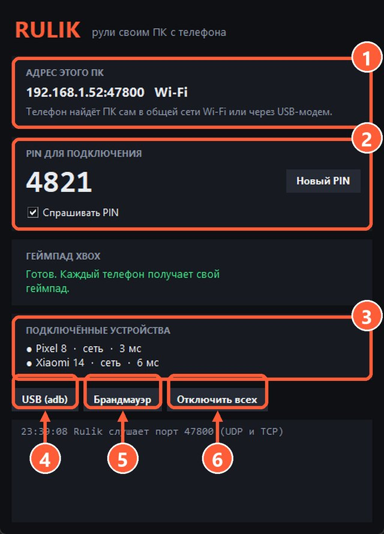

## Сервер запущен?

Сообщение «ПК не отвечает. Rulik Server запущен?» значит, что телефон не получил ответа. Проверьте, что окно Rulik Server открыто, а не закрыто случайно.

## Одна сеть

Телефон и ПК должны быть в одной сети. Частые ловушки:

- Телефон подключён к **гостевой сети** роутера: она специально изолирована от остальных устройств.
- Телефон ушёл на **мобильный интернет**, потому что Wi-Fi плохо ловит.
- На ПК или телефоне включён **VPN**: он может уводить трафик мимо локальной сети.
- В некоторых роутерах включена **изоляция клиентов** (AP isolation). Её можно выключить в настройках роутера.

## Брандмауэр

Нажмите «Брандмауэр» в окне сервера: он добавит правило для порта 47800 сразу для всех типов сетей. Это особенно важно, если Windows считает вашу сеть общедоступной: так бывает с [USB-модемом](usb-tether.html) и новыми сетями.

Если стоит сторонний антивирус со своим брандмауэром, разрешите в нём Rulik Server.

## Ввести адрес вручную

Автоматический поиск иногда блокирует роутер. Нажмите «Ввести адрес вручную» и впишите адрес из окна сервера. Сервер показывает все адреса ПК и подписывает, к какой сети они относятся.

1 Адрес ПК
5 Кнопка «Брандмауэр»

## Неверный PIN

PIN виден в окне сервера. Если его меняли, введите новый.

## Ничего не помогло

Подключитесь по кабелю: [USB-модем](usb-tether.html) или [adb](adb.html). Если и так не работает, опишите проблему в [issue на GitHub](https://github.com/Wandraker/rulik/issues).
