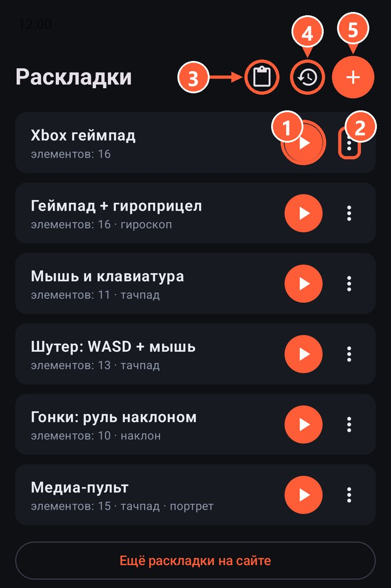
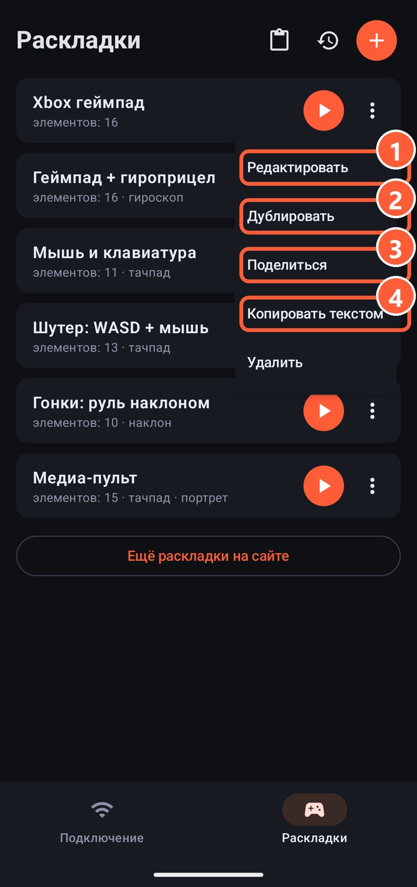

## Встроенные раскладки

| Раскладка | Для чего |
|---|---|
| Xbox геймпад | Полный геймпад: два стика, крестовина, ABXY, курки, бамперы |
| Геймпад + гироприцел | То же, плюс прицеливание поворотом телефона |
| Мышь и клавиатура | Тачпад, клавиши и набор текста для работы с ПК |
| Шутер: WASD + мышь | Для игр на клавиатуре и мыши: ходьба стиком, камера тачпадом |
| Гонки: руль наклоном | Руль наклоном телефона, газ и тормоз на курках |
| Медиа-пульт | Вертикальный пульт для фильмов: тачпад, громкость, пауза, треки, перемотка |

Удалили или испортили встроенную? В списке раскладок есть пункт «Вернуть стандартные раскладки».

1 Запустить раскладку
2 Меню раскладки
3 Импорт раскладки из буфера обмена
4 Вернуть стандартные раскладки
5 Новая пустая раскладка

## Что можно сделать с раскладкой

Нажмите ⋮ рядом с раскладкой:

- **Редактировать**: открывает [редактор](editor.html).
- **Дублировать**: делает копию, чтобы менять её, не трогая оригинал.
- **Поделиться**: отправляет раскладку текстом в любой мессенджер.
- **Копировать текстом**: кладёт раскладку в буфер обмена.
- **Удалить**.

1 Редактировать
2 Дублировать
3 Поделиться
4 Копировать текстом

## Импорт

Скопируйте текст раскладки (от друга или со страницы [«Раскладки»](../layouts.html)) и нажмите «Импорт из буфера» в списке раскладок.

Сделали удачную раскладку? Выложите её через [issue на GitHub](https://github.com/Wandraker/rulik/issues/new?title=Раскладка:%20), и она может попасть в каталог на сайте.
