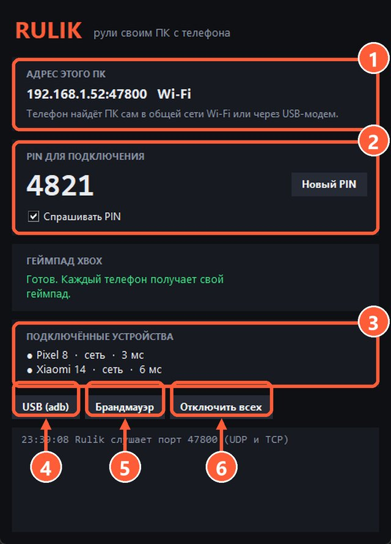

## PIN-код

По умолчанию сервер спрашивает PIN, который виден только в его окне. Телефон один раз вводит PIN при подключении.

- **Новый PIN**: меняет код. Если кажется, что PIN кто-то подсмотрел, смените его и нажмите «Отключить всех».
- **Спрашивать PIN**: можно выключить, если вы дома одни в сети. Лучше оставить включённым.
- **Отключить всех**: сразу выкидывает все подключённые телефоны.

2 PIN, кнопка «Новый PIN» и галочка «Спрашивать PIN»
6 Отключить всех

## Что сервер может и не может

Rulik Server принимает только ввод управления: кнопки геймпада, движения мыши, нажатия клавиш и текст. Доступа к файлам, экрану или камере у него нет, и в интернет он ничего не отправляет: связь идёт только внутри вашей сети или по кабелю.

Код открыт, всё это можно проверить: [github.com/Wandraker/rulik](https://github.com/Wandraker/rulik).
