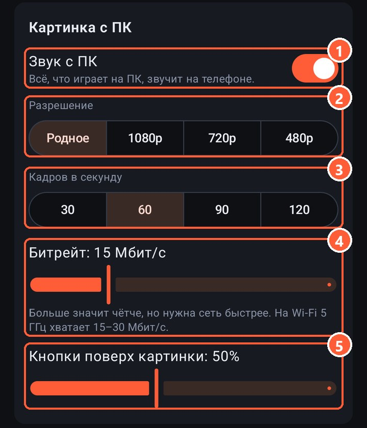

1 Звук с ПК на телефоне
2 Разрешение картинки
3 Кадров в секунду
4 Битрейт: сколько данных в секунду идёт по сети
5 Насколько видны кнопки раскладки поверх игры

## Что выбрать

| Сеть | Разрешение | Кадры | Битрейт |
|---|---|---|---|
| Кабель (USB-модем) | Родное | 60 | 30–50 Мбит/с |
| Wi-Fi 5 ГГц рядом с роутером | Родное или 1080p | 60 | 15–30 Мбит/с |
| Wi-Fi 2,4 ГГц или через стену | 720p | 60 | 6–10 Мбит/с |
| Совсем плохая сеть | 480p | 30 | 3–5 Мбит/с |

«Родное» значит такое же, как у монитора ПК. Экран телефона маленький, поэтому 1080p и 1440p на нём почти не отличить, а сети с 1080p заметно легче.

90 и 120 кадров имеют смысл, если экран телефона их показывает, а ПК успевает выдавать игру с такой частотой.

## Задержка

Задержка складывается из сети ([пинг](lag.html)), сжатия видеокартой (несколько миллисекунд) и декодирования на телефоне. Если в настройках включён пинг, в углу видно, сколько миллисекунд кадр шёл от прихода до экрана. Всё вместе обычно 20–40 мс по Wi-Fi 5 ГГц и меньше по кабелю.

Помогает то же, что и при [лагах](lag.html): 5 ГГц, ПК по кабелю к роутеру, выключенное энергосбережение.

## Квадраты и замирания

Если пакет с куском кадра потерялся, телефон не показывает испорченную картинку, а ждёт следующий целый кадр. Это может занять до секунды. Если замирает часто, сеть не тянет такой битрейт: уменьшите его.

## Звук

Телефон играет всё, что звучит на ПК: игру, музыку, уведомления. Звук идёт без сжатия, около 3 Мбит/с. Если он не нужен, выключите «Звук с ПК» и разгрузите сеть.
