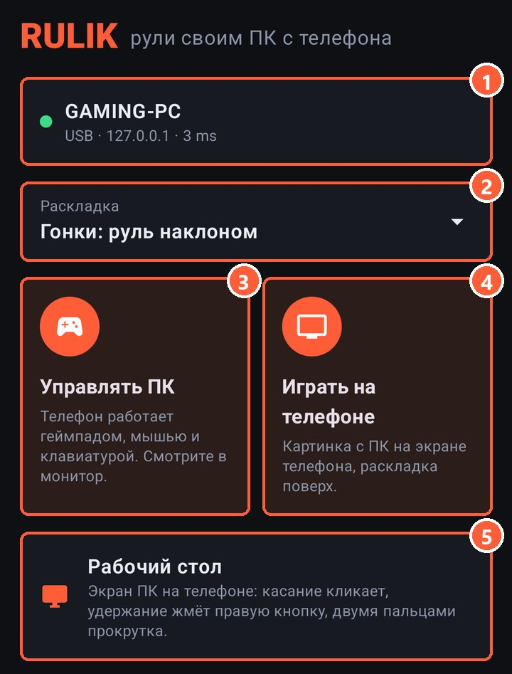
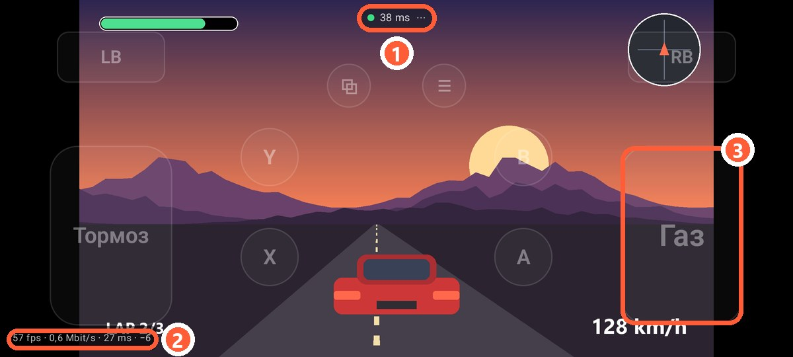
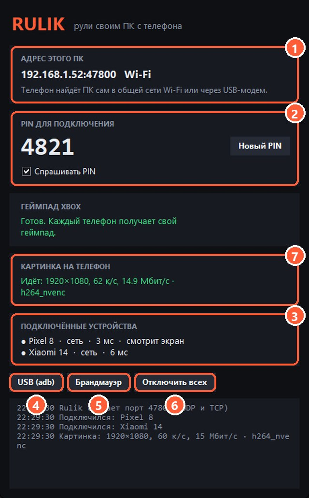

## Как это работает

ПК снимает свой экран, сжимает его видеокартой и отправляет на телефон вместе со звуком. Телефон показывает картинку и рисует поверх неё вашу раскладку. Нажатия уходят на ПК так же, как в обычном режиме, поэтому работают все раскладки: геймпад, клавиатура, мышь, гироскоп.

Сама игра запускается и считается на ПК, телефон только показывает видео. Поэтому на телефоне пойдёт любая игра, которая тянет ваш ПК.

## Как включить

1. Подключите телефон к ПК, как обычно: по [Wi-Fi](wifi.html) или [кабелю](usb-tether.html).
2. На главном экране выберите раскладку.
3. Нажмите «Играть на телефоне».

1 ПК, к которому вы подключены. Нажмите, чтобы сменить
2 Раскладка, которой будете играть
3 Обычный режим: телефон работает геймпадом, смотрите в монитор
4 Картинка с ПК на телефоне, раскладка поверх
5 [Рабочий стол](desktop.html): экран ПК, которым управляете пальцем

1 Пинг и меню: клавиатура, редактор раскладки, выход
2 Кадры в секунду, скорость потока и задержка декодирования. Видно, если в настройках включён пинг
3 Кнопки раскладки полупрозрачные, чтобы не закрывать игру

Картинка в этом режиме всегда альбомная, даже если раскладка сделана для портретного экрана.

## Что нужно на ПК

- **Rulik Server 0.3.0 или новее.** Старый сервер картинку не отдаёт, приложение об этом скажет.
- **ffmpeg.** Им сервер снимает экран и сжимает видео. Если его нет, в окне сервера появится кнопка «Скачать ffmpeg»: это около 100 МБ, один раз.
- **Видеокарта, которая умеет сжимать видео.** Подходят почти все за последние 10 лет: NVIDIA (NVENC), AMD (AMF), Intel (Quick Sync). Если такой нет, сервер сожмёт видео процессором, но это медленнее.

7 Состояние: размер, кадры, скорость потока и чем сжимается видео
3 Телефон, который смотрит экран, помечен «смотрит экран»

## Несколько телефонов

Смотреть могут сразу несколько телефонов, картинка у всех одна. Если два телефона попросят разное качество, победит тот, кто попросил последним.

## Если не работает

- **«Жду картинку с ПК…» и ничего не происходит.** Посмотрите в окно сервера: если ffmpeg не смог начать, там будет его ошибка.
- **Чёрный экран в игре.** Некоторые игры в эксклюзивном полноэкранном режиме не дают себя снимать. Переключите игру в «оконный без рамки».
- **Тормозит или сыпется картинка.** Смотрите [качество картинки](stream-quality.html): уменьшите битрейт или разрешение.
