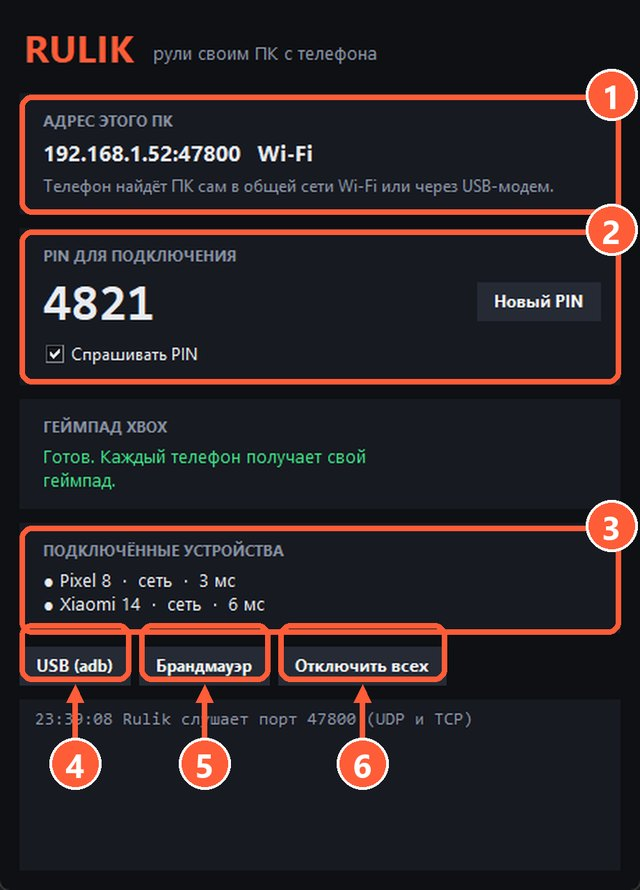

## Как подключиться

1. Подключите телефон к ПК кабелем.
2. В настройках Android включите «USB-модем» (обычно раздел «Точка доступа и модем»).
3. В приложении оставьте вкладку Wi-Fi: ПК появится в списке, а связь пойдёт по проводу.

## Брандмауэр

Windows помечает сеть от телефона как общедоступную и по умолчанию не пускает из неё входящие подключения. Сервер это видит и пишет предупреждение.

> Нажмите «Брандмауэр» в окне сервера один раз: правило подействует для любых сетей.

5 «Брандмауэр» добавляет правило для порта 47800 во всех сетях

## Новая сеть не появилась

Если после включения модема в Windows не появилась новая сеть, откройте «Диспетчер устройств». Телефон должен определиться как «Remote NDIS based Internet Sharing Device».

- Попробуйте другой кабель: некоторые кабели только заряжают и не передают данные.
- Попробуйте другой USB-порт, лучше прямо на материнской плате.

Не получается? Подключитесь [через adb](adb.html).
