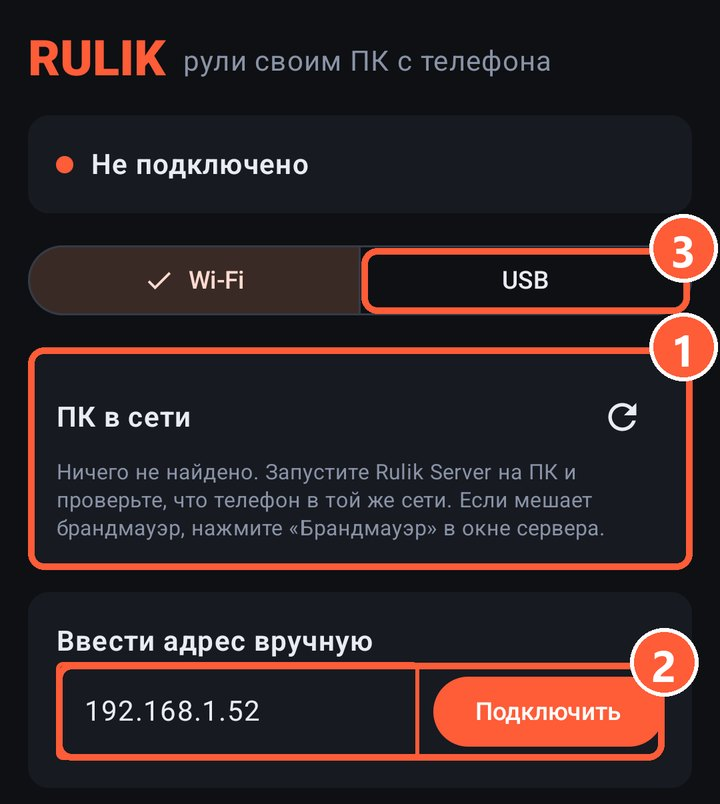

## Как подключиться

Телефон и ПК должны быть в одной сети. ПК может быть подключён к роутеру кабелем, это даже лучше.

1. Запустите Rulik Server на ПК.
2. В приложении откройте вкладку «ПК»: компьютер появится в списке «ПК в сети».
3. Нажмите на него и введите PIN из окна сервера.

Поиск работает широковещательным пакетом по локальной сети, поэтому вводить ничего не нужно.

1 Сюда попадают все ПК, где запущен Rulik Server
2 Ручной ввод адреса
3 Переключение на подключение по кабелю

## Ввести адрес вручную

Если ПК не находится, нажмите «Ввести адрес вручную» и впишите адрес из окна сервера, например `192.168.1.52`. В окне сервера может быть несколько адресов: берите тот, что относится к вашей домашней сети.

> Не находится и вручную? Нажмите «Брандмауэр» в окне сервера: он добавит правило для порта 47800. Остальные причины в статье [ПК не находится](not-found.html).

## Как сделать быстрее

- Подключите телефон к Wi-Fi 5 ГГц, а ПК к роутеру кабелем.
- Не стойте далеко от роутера и за толстыми стенами.

Подробнее в статье [Если лагает](lag.html).
